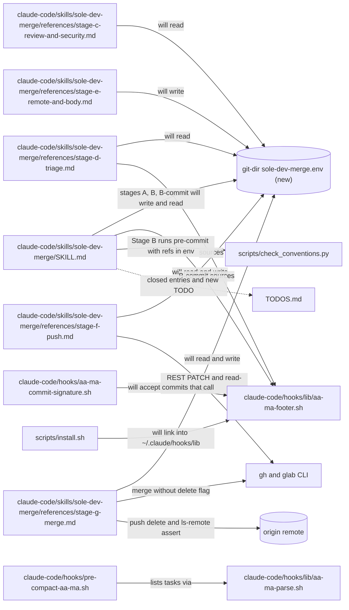
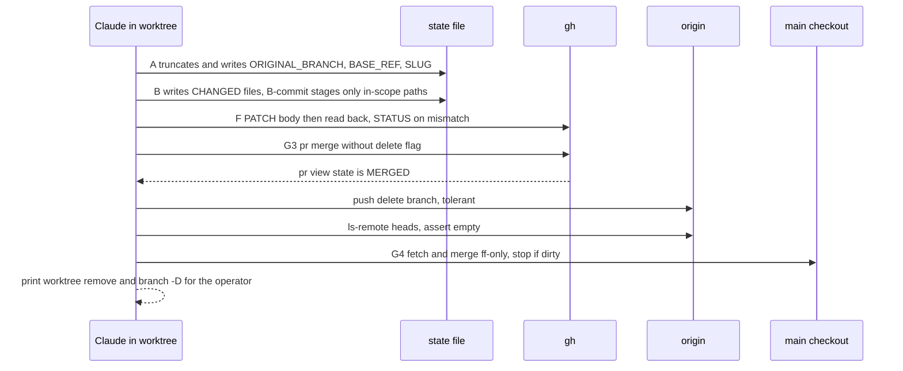
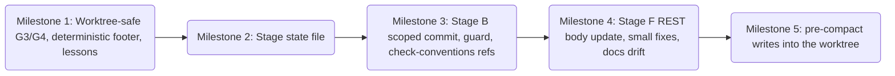

# sole-dev-merge-fixes Plan

**Objective:** Fix the `/sole-dev-merge` defects that keep recurring and are worked around by hand (L-1332, L-1309, L-1347, L-048, check-conventions "no diff source"), plus the defects a fresh re-check found. Log each as a lesson before fixing it.
**Owner:** Ste (Stephen Newhouse) + AI
**Created:** 2026-10-15
**Last Updated:** 2026-10-15 (rev 4, after plan-verification re-check)
**Branch / worktree:** `fix/sole-dev-merge-fixes` at `.worktrees/fix/sole-dev-merge-fixes`, cut from main `1bc3849`
**Spec:** the 2026-10-14 sole-dev-merge fixes spec (F1–F5, facts E1–E33, Q1–Q9), kept outside this repo. Every fact this plan relies on is copied, re-verified at `1bc3849`, into `sole-dev-merge-fixes-reference.md`.
**Diagram-Waiver:** none

> **For agentic workers:** execute milestone by milestone with `/execute-aa-ma-milestone`. Sub-steps use RED → GREEN commit pairs. Each milestone is one PR.

---

## 0. Repository, setup and coordination

- **Live skill:** `~/.claude/skills/sole-dev-merge` and every `~/.claude/hooks/lib/*.sh` resolve into the **main checkout**.
  - Nothing here goes live until a milestone PR merges and main is pulled.
  - Never edit the main checkout while code-conventions-impact (CCI) is mid-milestone (L-066).
- **Parallel plan (CCI):** active, M10–M14 and M16 pending (about 10.5 days left).
  - Do not edit `src/aa_ma/plan_parsers.py` (CCI 10.5), `claude-code/rules/engineering-standards.md` (CCI M11), or CHANGELOG headings (CCI M13/M14). Add bullets under `## Unreleased → ### Fixed` only.
  - Aim to merge M5 before CCI M14 cuts v0.18.0.
  - Files shared with pending CCI work, in different hunks. Expect rebases and moved line numbers, not clashes of intent:
    - `claude-code/hooks/lib/aa-ma-parse.sh` (CCI M11 adds `aa_ma_impact` and `aa_ma_milestone_base`);
    - `docs/spec/aa-ma-specification.md` (M10, M11, M13);
    - `scripts/install.sh` (M10, M12, M14);
    - `TODOS.md` and `CHANGELOG.md` (M13, M14).
    Rebase onto main before each PR and re-check every line anchor this plan cites.
  - G4 fast-forwarding the main checkout counts as editing main while a CCI session works there (L-066). It is safe only because G4 stops on any tracked change (`MAIN_CHECKOUT_DIRTY`). Never weaken that check.
- **Two active plans on main from the M1 merge on.**
  - `emit_aa_ma_footer` picks `find … | head -1` (`claude-code/hooks/lib/aa-ma-footer.sh:30`), which is arbitrary. So the footer fix (Sub-step 1.6) **must ship in the M1 PR**, the same PR that first puts this plan's files on main.
  - `aa-ma-commit-signature.sh` accepts any active plan's footer, but only plans visible from the session's `$PWD` (`:99`), and only in the literal command text (`:116-131`). Two consequences:
    - **Execution sessions for this plan start in the worktree** (decided 2026-10-15). A session rooted in main can't see this plan until M1 merges, so its commits are blocked (probed rc=2). Starting in the worktree also keeps the pre-compact hook's lines (L-1347) out of main for this plan's own work.
    - The skill's `-m "…${FOOTER}"` commits (B-commit, D) are blocked whenever a plan is visible, because the hook never sees the expanded footer. This predates the plan; Sub-step 1.7 fixes it.
  - The session-start banner and commit-drift warnings will mention both plans. These are advisory and accepted.
- **Bootstrap hazard (M1 only).** M1's PR is merged by the *unfixed* live skill.
  - At G3, merge without `--delete-branch`, then `git push origin --delete fix/sole-dev-merge-fixes` and assert that `git ls-remote --heads origin fix/sole-dev-merge-fixes` prints nothing (L-1332).
  - At G4, **don't run the unfixed G4 block at all**: its `ORIGINAL_BRANCH:-feature` default and its `checkout` are the bugs. After checking the main checkout for hook lines (L-1347), run `git -C <main> fetch origin`, then `git -C <main> merge --ff-only origin/main`.
  - Before the unfixed B-commit, run `git status --porcelain`, and stash or remove any untracked out-of-scope file (E16: `git add -A` would sweep it in). If B-commit has something to commit, the hook blocks its `${FOOTER}` commit, so commit those exact paths by hand with the literal footer.
  - The unfixed Stage C silently skips Ruff S and ShellCheck, because CHANGED_PY/SH are never set. Run `uv run ruff check --isolated --select S <changed .py>` and `shellcheck <changed .sh>` by hand and record the output.
  - M2–M5 are merged by the fixed skill, so each merge exercises it.
- **Public repo (L-029, L-039):** no private repo names, paths or client names in any file or commit message on this branch.
  - Raw probe output (stderr, `pwd`, stdin `cwd`, systemMessages) is redacted to `<scratch>`, `<main>`, `<wt>` and `<home>` **before** it is written to any AA-MA file.
  - Every milestone gate repeats two checks over all AA-MA files plus the diff: the denylist count (count only) and `grep -nE '/ho[m]e/|/tm[p]/claude-'`. Both must be 0.
- **Merge-dependent evidence (L-037):** criteria tagged `[post-merge]` are verified at the next milestone's N.0 (M5: at 5.5). Each HARD gate is approved on its pre-merge criteria, and the milestone flips to COMPLETE once its post-merge criteria are recorded.

## 1. Executive Summary

The skill's own steps contradict four lessons, and its tests assert the bad commands, so every merge needs hand workarounds. Five milestones, each one PR:
- **M1:** worktree-safe G3/G4 and a deterministic footer helper.
- **M2:** a stage state file, so values survive between Bash calls.
- **M3:** Stage B: scoped commit, L-007 guard, check-conventions refs, visible exit codes.
- **M4:** Stage F REST body update, plus the small fixes.
- **M5:** pre-compact hook writes into the worktree, not the main checkout.

## 2. Engineering Standards Declaration (element #12)

Themes: **[A] all**, declared by Ste 2026-10-15.

| Theme | Applies because |
|---|---|
| 1 Verification & Truth | Three facts are UNVERIFIED and need live probes: E6 gh's rc, the state file across separate Bash calls, and PreCompact stdin `cwd` vs `$PWD`. All three milestones are `Prototype-Required: YES`. Every merge after M1 is a live test of the fix. |
| 2 Development Principles | RED bats first. The tests that pin the bugs (`test_stage_g_merge.bats:100-121`, `test_stage_f_idempotent.bats:106-116`) are flipped in the RED commit. KISS: no new libraries; the state file is a plain `KEY=<base64>` file. |
| 3 Reasoning & Planning | Grill-with-docs, 3 rounds, 11 decisions (context-log). First-principles on the footer rule and the L-1347 root cause. |
| 4 Safety & Continuity | The shared hooks lib and a live skill are used by the parallel CCI session. Changes are additive where possible, and a helper's default behaviour is kept (the root argument is optional). Lessons L-1332/L-1347/L-1309/L-1351 were applied, and new forge lessons are logged before the fixes. |
| 5 Execution Checklist | Every milestone is `Gate: HARD` with `Critical-Path: hook-modification` (`engineering-standards.md:66`: gate/scan logic inside `claude-code/skills/**`, plus `claude-code/hooks/**`). Each needs `CRITICAL_PATH_REVIEW` and `PROTOTYPE` provenance entries where flagged. |
| 6 Sync & Commit Discipline | Result Log per sub-step and one PR per milestone. Commits carry `[AA-MA Plan] sole-dev-merge-fixes .claude/dev/active/sole-dev-merge-fixes`. |

Lessons applied: global L-1332, L-1347, L-1309, L-1351 (meta), L-1319 (no silent fail-open), L-1334 (pathspec commits), L-1350 (owner decisions); forge L-007, L-031, L-032, L-037 (post-merge in N.0), L-045 (bats lines that can't fail), L-048 (stage exact paths), L-050 (test with a real payload).

## 3. Dependencies and Assumptions (element #8)

**Dependencies:** git 2.53.0; gh 2.46.0; bats 1.13.0; pre-commit 4.5.1 (PATH) / 4.6.2 (.venv); shellcheck; jq; uv. Baseline: `bats tests/commands/sole-dev-merge/` gives 75/75 at `1bc3849`.

**Assumptions:** each is verified or carries a probe.
| ID | Assumption | Status |
|---|---|---|
| A1 | A worktree's `git rev-parse --git-dir` is per-worktree, so a state file under it doesn't collide with the main checkout or with other worktrees | Probe in 2.0 |
| A2 | Every stage block is run by Claude as its own Bash call, with `cd <worktree> && …` when the session started in main | Verified in transcripts of PRs #37 and #41 (972 `cd`s in one session) |
| A3 | `gh api -X PATCH … -F body=@file` sends the file contents as a string | gh manual: `-F` reads the value from `@<path>`. Live probe in 4.0 |
| A4 | PreCompact stdin carries `cwd` | Docs: a common hook input field. Fixture `tests/fixtures/hook-payloads/PreCompact.json:4`. Its value under worktree `cd` is the UNVERIFIED part (probe 5.0) |
| A5 | gh's rc when `--delete-branch` fails locally in a worktree | **[U]** (E6). The F1 design decides from server state, so either rc is handled (1.1 test "gh rc=1 but MERGED"). Probe 1.0 records it |
| A6 | `gh pr view --json state` reads `MERGED` right after `gh pr merge` | aa-ma-forge has no merge queue, no rulesets and `allow_auto_merge=false` (probed). In a merge-queue repo the state stays OPEN, so G3 prints `STATUS: MERGE_FAILED` and deletes nothing. That fails safe; the G3 prose documents it |
| A7 | The server does not auto-delete head branches | `delete_branch_on_merge=false` (probed), so G3's explicit delete is needed. The already-deleted path is still tested |
| A8 | `main` is not protected | Probed: `branches/main/protection` → 404; rulesets `[]`. Changes reach main by PR by convention, not enforcement |

## 4. Stepwise Implementation Plan (elements #2, #4, #5, #6, #9)

Per-sub-step acceptance criteria, Mode and Dependencies are in `sole-dev-merge-fixes-tasks.md`. This section gives the design and the code an implementer needs.

### Milestone 1: Worktree-safe G3/G4, deterministic footer, lessons (PR 1)

**1.0 Session root, plan commit, baselines, probe E6 (Prototype, HITL).**
- Start the session in `.worktrees/fix/sole-dev-merge-fixes`. After Ste approves the plan, the first commit is the AA-MA files: `docs(aa-ma): sole-dev-merge-fixes plan` with the plan footer. Commit the exact paths; they carry `Test-Command`, which must reach main with M1.
- Record the baselines: SDM `ok` = 75, and the `tests/hooks` `ok` count.
- Probe E6, only if Ste approves:
  - The gh token lacks the `delete_repo` scope (probed), so Ste first runs `! gh auth refresh -s delete_repo`.
  - Steps: `gh repo create <owner>/sdm-e6-probe --private --clone` into the scratchpad; add a commit on `main` and push; `git worktree add ../wt -b probe`; commit and push `probe`; `gh pr create --fill`; then, from `../wt`, `gh pr merge <n> --rebase --delete-branch; echo rc=$?`.
  - Record the rc and stderr, and `git ls-remote --heads origin probe`. Then `gh repo delete <owner>/sdm-e6-probe --yes`.
- The verdict is `E6 rc=<n>` when approved, or `E6 [U] — covered by the 'gh rc=1 but MERGED' test` when declined. Write `[ts] PROTOTYPE — Milestone 1: Worktree-safe G3/G4, deterministic footer, lessons — <verdict>`.

**1.1 RED, G3 (`tests/commands/sole-dev-merge/test_stage_g_merge.bats`).**
- Flip `:100-121` to assert zero `--delete-branch`.
- Add `export ORIGINAL_BRANCH=feature` to `setup()` (`:47-49`). No test sets it today, and G3/G4 now require it; the existing gitlab-green (`:188`) and G4 (`:149`) tests depend on this.
- Add the cases below. They need stub arms in `fixtures/bin/gh`:
  - `pr view … --json state` → `${GH_PR_STATE:-MERGED}`. This arm must come **before** the `GH_PR_EXISTS` check, or every G3 test reads `UNKNOWN`.
  - `pr merge` → exit `${GH_MERGE_RC:-0}`.
  - `pr view … --json headRefName` → `${GH_HEAD_REF:-feature}`.
- Extra G3 cases (security audit):
  - `GH_HEAD_REF=other` → `ABORT … head is 'other'`, rc 1, no merge.
  - `ORIGINAL_BRANCH=main` → ABORT, rc 1, no merge.
  - `ORIGINAL_BRANCH='--output=x'` → ABORT (check-ref-format), and file `x` is not created.
  - A tag `refs/tags/feature` on the bare remote survives the delete.
  - A remote branch `other/feature` gives no false `BRANCH_NOT_DELETED`.
- Sandbox: `_sandbox_with_pushed_feature` plus the real bare remote.

```bash
@test "G3: green + rebase → merge without --delete-branch, then push --delete, ls-remote empty" {
    _sandbox_with_pushed_feature
    export CI_STATE=green MERGE_STRATEGY=rebase ORIGINAL_BRANCH=feature
    run bash "$G3_SCRIPT"
    [ "$status" -eq 0 ]
    [ "$(grep -cE '^gh pr merge 42 --rebase$' "$CLI_LOG")" -eq 1 ]
    [ "$(grep -c -- '--delete-branch' "$CLI_LOG")" -eq 0 ]
    [ -z "$(git ls-remote --heads origin feature)" ]
    [[ "$output" == *"MERGE_DISPATCHED=1"* ]]
}
@test "G3: state != MERGED → STATUS: MERGE_FAILED, no push --delete" {
    _sandbox_with_pushed_feature
    export CI_STATE=green GH_PR_STATE=OPEN ORIGINAL_BRANCH=feature
    run bash "$G3_SCRIPT"
    [ "$status" -eq 0 ]
    [[ "$output" == *"STATUS: MERGE_FAILED"* ]]
    [[ "$output" == *"MERGE_DISPATCHED=0"* ]]
    [ -n "$(git ls-remote --heads origin feature)" ]
}
@test "G3: gh pr merge rc=1 but state MERGED → treated as merged (E6 either way)" {
    _sandbox_with_pushed_feature
    export CI_STATE=green GH_MERGE_RC=1 ORIGINAL_BRANCH=feature
    run bash "$G3_SCRIPT"
    [ "$status" -eq 0 ]
    [[ "$output" == *"MERGE_DISPATCHED=1"* ]]
    [ -z "$(git ls-remote --heads origin feature)" ]
}
@test "G3: branch already deleted server-side → no abort, ls-remote assert passes" {
    _sandbox_with_pushed_feature
    git --git-dir="$BARE_REMOTE" update-ref -d refs/heads/feature
    export CI_STATE=green ORIGINAL_BRANCH=feature
    run bash "$G3_SCRIPT"
    [ "$status" -eq 0 ]
    [[ "$output" == *"MERGE_DISPATCHED=1"* ]]
    [[ "$output" != *"BRANCH_NOT_DELETED"* ]]
}
@test "G3: remote refuses delete → STATUS: BRANCH_NOT_DELETED (warning), rc 0" {
    _sandbox_with_pushed_feature
    printf '#!/bin/sh\nwhile read o n r; do [ "$n" = 0000000000000000000000000000000000000000 ] && exit 1; done; exit 0\n' \
        > "$BARE_REMOTE/hooks/pre-receive"; chmod +x "$BARE_REMOTE/hooks/pre-receive"
    export CI_STATE=green ORIGINAL_BRANCH=feature
    run bash "$G3_SCRIPT"
    [ "$status" -eq 0 ]
    [[ "$output" == *"STATUS: BRANCH_NOT_DELETED — feature"* ]]
}
@test "G3: unknown REMOTE_CHOICE → STATUS: REMOTE_UNKNOWN, MERGE_DISPATCHED=0" {
    _sandbox_with_pushed_feature
    export CI_STATE=green REMOTE_CHOICE=bitbucket ORIGINAL_BRANCH=feature
    run bash "$G3_SCRIPT"
    [ "$status" -eq 0 ]
    [[ "$output" == *"STATUS: REMOTE_UNKNOWN"* ]]
    [[ "$output" != *"merged"* ]]
}
@test "G3: ORIGINAL_BRANCH unset → fails loud before any merge" {
    _sandbox_with_pushed_feature
    unset ORIGINAL_BRANCH; export CI_STATE=green
    run bash "$G3_SCRIPT"
    [ "$status" -ne 0 ]
    [ "$(grep -c 'pr merge' "$CLI_LOG")" -eq 0 ]
}
```
- The existing G3 tests stay green: timeout `:123`, failed `:134`, gitlab-green `:188`, gitlab-timeout `:200`, unknown `:213`. There is no G3 `blocked` test; G2's is in `test_stage_g_poll.bats:138`.
- **RED evidence:** record the TAP `not ok` count on the unfixed G3. Name in the Result Log, as a guard, any new case that already passes on unfixed code.
- **Commit:** `test(sole-dev-merge): RED — G3 merges without --delete-branch, decides by PR state (L-1332)`.

**1.2 GREEN, G3 (`references/stage-g-merge.md:144-205`).** Replace the `green)` arm:

```bash
    green)
        : "${ORIGINAL_BRANCH:?Stage G3 needs ORIGINAL_BRANCH from Stage A}"
        DEFAULT_BRANCH="${DEFAULT_BRANCH:-main}"
        case "$REMOTE_CHOICE" in
        github)
            # why: refuse before any state change, so a wrong or hostile value can't delete another ref (rc 1, pre-flight class)
            git check-ref-format --branch "$ORIGINAL_BRANCH" >/dev/null \
                || { echo "ABORT: Stage G3: ORIGINAL_BRANCH '$ORIGINAL_BRANCH' is not a valid branch name"; exit 1; }
            [[ "$ORIGINAL_BRANCH" != "$DEFAULT_BRANCH" ]] \
                || { echo "ABORT: Stage G3: ORIGINAL_BRANCH is the default branch"; exit 1; }
            HEAD_REF=$(gh pr view "$PR_NUM" --json headRefName --jq .headRefName)
            [[ "$HEAD_REF" == "$ORIGINAL_BRANCH" ]] \
                || { echo "ABORT: Stage G3: PR $PR_NUM head is '$HEAD_REF', not '$ORIGINAL_BRANCH'"; exit 1; }
            # why: gh's delete flag runs a local checkout that fails in a worktree and skips the remote
            # delete (L-1332). Merge, then decide from the server state, not gh's rc (E6).
            gh pr merge "$PR_NUM" --"$MERGE_STRATEGY" || echo "Stage G3: gh pr merge rc=$? — checking PR state"
            # why: an unreadable state counts as not merged, so the step fails safe (no delete)
            STATE=$(gh pr view "$PR_NUM" --json state --jq .state 2>/dev/null || echo UNKNOWN)
            if [[ "$STATE" != MERGED ]]; then
                echo "STATUS: MERGE_FAILED — state=$STATE — see $PR_URL"; export MERGE_DISPATCHED=0
                echo "MERGE_DISPATCHED=0"; exit 0
            fi
            # why: full ref, so a same-named tag or branch is never deleted; rc 1 if already gone (E12), ls-remote decides
            git push -q origin ":refs/heads/$ORIGINAL_BRANCH" 2>/dev/null \
                || echo "Stage G3: push --delete rc=$? (already gone server-side?) — checking ls-remote"
            if [[ -n "$(git ls-remote origin "refs/heads/$ORIGINAL_BRANCH")" ]]; then
                echo "STATUS: BRANCH_NOT_DELETED — $ORIGINAL_BRANCH"
            fi ;;
        gitlab)
            MR_IID="${MR_IID:-$PR_NUM}"
            if [[ "$MERGE_STRATEGY" == "rebase" ]]; then
                glab mr merge "$MR_IID" --rebase --remove-source-branch --yes
            else
                glab mr merge "$MR_IID" --remove-source-branch --yes
            fi ;;
        *)
            echo "STATUS: REMOTE_UNKNOWN — REMOTE_CHOICE='$REMOTE_CHOICE'"; export MERGE_DISPATCHED=0
            echo "MERGE_DISPATCHED=0"; exit 0 ;;
        esac
        export MERGE_DISPATCHED=1
        echo "MERGE_DISPATCHED=1"
        echo "Stage G3: merged $PR_NUM (strategy=$MERGE_STRATEGY)"
        ;;
```
- Update the G3 prose (`:9-34`) and SKILL.md's description line `:13`.
- **Commit:** `fix(sole-dev-merge): G3 merges without --delete-branch, deletes and asserts the remote branch (L-1332)`.

**1.3 RED, G4.** Keep the existing non-worktree test (`:149`) green. Its path changes only in two ways: `fetch` plus `merge --ff-only` replace `pull` (E10), and the branch delete logs on failure. Add a worktree fixture helper `_sandbox_worktree` (main checkout `$BATS_TMP`, worktree `$BATS_TMP/.worktrees/feature`, bare remote). Cases:
- (AC2.2) Run from the worktree with a clean main checkout → rc 0. The main checkout's HEAD equals the bare remote's main; the worktree HEAD and branch are unchanged; output contains `worktree remove` and `branch -D feature`, and the `--stat` summary is shown.
- (AC2.2b) A main checkout path with a space → the printed cleanup commands are `%q`-quoted (`eval` of the printed line runs on a dry-run copy).
- (AC2.3) A dirty tracked file in the main checkout → `STATUS: MAIN_CHECKOUT_DIRTY`, rc 0, and the main checkout is byte-identical before and after (sha256 of `git diff` plus `git status`).
- (AC2.3b) An *untracked* file in the main checkout → not dirty; it is fast-forwarded (`status --porcelain --untracked-files=no`).
- (AC2.4) Run from a subdirectory of the main checkout → non-worktree path.
- (AC2.5) The main worktree is on branch `other` → `other` is untouched; local `main` is fast-forwarded by `git fetch origin main:main`, or `STATUS: MAIN_NOT_UPDATED` is printed.
- (AC2.6) `ORIGINAL_BRANCH` unset → fails loud, and `git branch -D` is never called. This replaces the `feature` default (`:214`).
- **Commit:** `test(sole-dev-merge): RED — G4 cleans up from a worktree without checkout`.

**1.4 GREEN, G4 (`stage-g-merge.md:209-236`).** Worktree detection (E7):
```bash
: "${ORIGINAL_BRANCH:?Stage G4 needs ORIGINAL_BRANCH from Stage A}"
# why: refuse option-shaped or invalid names before they reach diff/branch (security audit: --output= clobber)
git check-ref-format --branch "$ORIGINAL_BRANCH" >/dev/null || { echo "ABORT: Stage G4: invalid ORIGINAL_BRANCH"; exit 1; }
GIT_DIR_ABS=$(git rev-parse --path-format=absolute --git-dir)
COMMON_ABS=$(git rev-parse --path-format=absolute --git-common-dir)
if [[ "$GIT_DIR_ABS" == "$COMMON_ABS" ]]; then
    git checkout -q "$DEFAULT_BRANCH"
    git fetch -q --prune origin                       # why: no `pull` — pull.rebase=true breaks --ff-only (E10)
    git merge -q --ff-only "origin/$DEFAULT_BRANCH"
    git branch -q -D "$ORIGINAL_BRANCH" || echo "Stage G4: local branch $ORIGINAL_BRANCH not deleted (rc=$?)"
else
    WT_LIST=$(git worktree list --porcelain)           # why: captured once; no early-exit pipe under pipefail
    MAIN_WT=$(awk '/^worktree /{ if (!w) w = substr($0, 10) } END { print w }' <<<"$WT_LIST")
    git -C "$MAIN_WT" fetch -q --prune origin
    if [[ "$(git -C "$MAIN_WT" branch --show-current)" != "$DEFAULT_BRANCH" ]]; then
        if [[ $'\n'"$WT_LIST"$'\n' == *$'\n'"branch refs/heads/$DEFAULT_BRANCH"$'\n'* ]]; then
            echo "STATUS: MAIN_NOT_UPDATED — $DEFAULT_BRANCH is checked out in another worktree"
        else
            git -C "$MAIN_WT" fetch -q origin "$DEFAULT_BRANCH:$DEFAULT_BRANCH" \
                || echo "STATUS: MAIN_NOT_UPDATED — non-fast-forward"
        fi
    elif [[ -n "$(git -C "$MAIN_WT" status --porcelain --untracked-files=no)" ]]; then
        echo "STATUS: MAIN_CHECKOUT_DIRTY — $(git -C "$MAIN_WT" status --porcelain --untracked-files=no | tr '\n' ' ')"
        exit 0                                        # why: never auto-revert (L-1347, Q5)
    else
        git -C "$MAIN_WT" merge -q --ff-only "origin/$DEFAULT_BRANCH"
    fi
    git -C "$MAIN_WT" diff --stat "refs/heads/$ORIGINAL_BRANCH" "refs/heads/$DEFAULT_BRANCH" -- || true   # why: shown for the L-1332 check only
    echo "Operator cleanup (after reviewing the diff above):"
    printf '  git -C %q worktree remove %q\n' "$MAIN_WT" "$(git rev-parse --show-toplevel)"
    printf '  git -C %q branch -D %q\n' "$MAIN_WT" "$ORIGINAL_BRANCH"
    WT_NOTE=" worktree=$(git rev-parse --show-toplevel)"
fi
MERGE_SHA=$(git -C "${MAIN_WT:-.}" rev-parse --short "$DEFAULT_BRANCH")
echo "Stage G4: cleanup OK — $DEFAULT_BRANCH at $MERGE_SHA${WT_NOTE:-}"
echo "Final: branch=$ORIGINAL_BRANCH merged into $DEFAULT_BRANCH (sha=$MERGE_SHA)${PR_URL:+ — $PR_URL}"
echo "STATUS: OK${WT_NOTE:-}"
```
- The block keeps its `PR_URL="${PR_URL:-}"` and `DEFAULT_BRANCH="${DEFAULT_BRANCH:-main}"` lines; only the `ORIGINAL_BRANCH` default goes.
- **Commit:** `fix(sole-dev-merge): G4 fast-forwards the main checkout from a worktree, prints cleanup`.

**1.5 RED, footer helper (`tests/hooks/aa-ma-footer.bats`, new: no footer test file exists at `1bc3849`).** Cases:
- 0 plans → `[ad-hoc]`.
- 1 plan → that plan.
- 2 plans, branch touches only `.claude/dev/active/b/` → `b`.
- 2 plans, branch touches both → `[ad-hoc]` plus a stderr `WARN`.
- 2 plans, branch touches neither → `[ad-hoc]` plus `WARN`.
- Detached HEAD → falls back without crashing.
- Fixtures: sandboxes built with `remote add` plus `push` have no `origin/HEAD`, so the fixtures run `git remote set-head origin main`. One case deletes `origin/HEAD` to test the `origin/main` fallback. One case uses an untracked plan dir. Tests source the helper **without** `set -o pipefail`.
- The WARN is printed only when more than one plan is active and the touched count isn't 1.
- **Helper-path case:** in a repo without `claude-code/hooks/lib/aa-ma-footer.sh`, the extracted B-commit block still commits with a footer. It resolves `${AA_MA_FOOTER_HELPER:-…}`, then the repo path, then `${CLAUDE_HOME:-$HOME/.claude}/hooks/lib/aa-ma-footer.sh`, then a built-in `[ad-hoc]` fallback.
  - The test sets `CLAUDE_HOME` to a temp dir, so a real `~/.claude` link can't leak in. One case puts a helper there; one leaves it empty.
  - It reuses `SDM/fixtures/extract_stage.sh`, a cross-directory dependency named in the test header.
  - D uses the identical resolution snippet. A test asserts the two snippets are byte-identical (extracted with `sed` between marker comments), so D needs no ruff-CRITICAL setup.

**1.6 GREEN, footer (`claude-code/hooks/lib/aa-ma-footer.sh:25-37`; SKILL.md:248-249; stage-d-triage.md:26-27).**
```bash
emit_aa_ma_footer() {
    local root ref base plans=() touched=() d
    # why: outside a repo, use cwd; the plan scan then finds nothing, so [ad-hoc]
    root="$(git rev-parse --show-toplevel 2>/dev/null || echo .)"
    for d in "$root"/.claude/dev/active/*/; do [[ -d "$d" ]] && plans+=("$(basename "$d")"); done
    if (( ${#plans[@]} == 1 )); then touched=("${plans[0]}")
    elif (( ${#plans[@]} > 1 )); then
        # why: with parallel plans the branch's own plan is the one it changed (milestone branches
        # carry their plan's AA-MA files); anything else is ambiguous and must not guess.
        # why: no pipeline, so the fallback works without the caller's pipefail; no origin/HEAD → origin/main
        ref=$(git symbolic-ref -q --short refs/remotes/origin/HEAD) || ref=origin/main
        base=$(git merge-base HEAD "$ref" 2>/dev/null) || base=""   # why: no base → nothing touched → [ad-hoc] + WARN
        for d in "${plans[@]}"; do
            # why: diff sees committed and uncommitted tracked edits; ls-files adds a plan dir not yet in git
            if [[ -n "$base" ]] && [[ -n "$(git diff --name-only "$base" -- "$root/.claude/dev/active/$d")$(git ls-files --others --exclude-standard -- "$root/.claude/dev/active/$d")" ]]; then
                touched+=("$d")
            fi
        done
        (( ${#touched[@]} == 1 )) || echo "WARN: aa-ma-footer: ${#plans[@]} active plans, ${#touched[@]} touched on this branch — using [ad-hoc]" >&2
    fi
    if (( ${#touched[@]} == 1 )); then
        printf '\n\n[AA-MA Plan] %s .claude/dev/active/%s' "${touched[0]}" "${touched[0]}"
    else
        printf '\n\n[ad-hoc]'
    fi
}
```
- `git diff <base>` (without `--name-only HEAD`) covers both committed and uncommitted plan edits.
- In the skill blocks, replace the hard `source` with a resolution chain between `# footer-resolve:begin` and `# footer-resolve:end` marker comments. If no helper is found, define `emit_aa_ma_footer(){ printf '\n\n[ad-hoc]'; }` and print one line saying so (L-1319).
- Update the "Behaviour" header comment in `aa-ma-footer.sh` (`:15-19`).
- **Commits:** RED `test(hooks): RED — footer picks the branch's plan, falls back outside forge`; GREEN `fix(hooks): footer helper picks the plan the branch touched; skill resolves the helper outside forge`.

**1.7 RED/GREEN, commit-signature accepts the footer helper (`claude-code/hooks/aa-ma-commit-signature.sh` before step 7; `tests/hooks/commit-signature.bats`).**
- RED cases, with an active plan visible:
  - `FOOTER=$(emit_aa_ma_footer); git commit -m "x${FOOTER}"` → rc 0 (today rc 2).
  - The same commit with neither `emit_aa_ma_footer` nor a literal signature → still rc 2.
  - The 11 existing tests stay green.
- More RED cases (security audit): each of these must stay blocked (rc 2).
  - `git commit -m "no footer" # emit_aa_ma_footer`, where the name is only mentioned.
  - `emit_aa_ma_footer(){ :; }; FOOTER=$(emit_aa_ma_footer); git commit -m "x${FOOTER}"`, a redefined helper.
  - `FOOTER=$(emit_aa_ma_footer); git commit -m "${FOOTER} x"`, where the footer doesn't end the message.
  - `FOOTER=$(emit_aa_ma_footer); FOOTER=x; git commit -m "y${FOOTER}"`, where FOOTER is reassigned.
- GREEN: accept only the canonical shape:
  - `FOOTER=$(emit_aa_ma_footer)` appears;
  - the `-m` message ends with `${FOOTER}"`;
  - the command defines no `emit_aa_ma_footer()` function, except the exact `[ad-hoc]` fallback body from the skill's `footer-resolve` block;
  - `FOOTER=` is assigned exactly once.
  A `# why:` explains that this keeps the helper the only footer source. A `commit-msg` stage check that sees the real message is the stronger long-term option, recorded as a TODO.
- Add the rule to the hook's header rule table (`:13-22`).
- Commits: `test(hooks): RED — commit-signature accepts helper-built footers`; `fix(hooks): commit-signature trusts emit_aa_ma_footer`.

**1.8 RED/GREEN, pre-compact never follows a symlink (`claude-code/hooks/pre-compact-aa-ma.sh`; `tests/hooks/pre-compact.bats`). A live defect in every session (security audit, reproduced with a fake HOME); decided to ship in M1.**
- RED cases, each with a fake `HOME`:
  - the task's `provenance.log` is a committed symlink to `$HOME/.bashrc` → the target is byte-identical after the hook;
  - the same for `context-log.md`;
  - `reference.md` is a symlink to a file outside the repo → it is not copied into the snapshot;
  - the task dir itself is a symlink → skipped.
  - In each case: rc 0, one hooks.log line, and a systemMessage naming the skip count.
- GREEN: before any read or append, skip the task when its dir or the file is a symlink (`[[ -L ]]`), or when `realpath -e` of it is not under `realpath` of the task root. Log each skip (L-1319). The 13 existing tests stay green.

**1.9 RED/GREEN, install link for the footer helper (`scripts/install.sh`; `tests/hooks/install_dry_run.bats`).**
- RED: a dry-run case asserts that install.sh plans the link `~/.claude/hooks/lib/aa-ma-footer.sh` → `claude-code/hooks/lib/aa-ma-footer.sh`.
- GREEN: one `create_symlink` block beside the `aa-ma-log.sh` block (`install.sh:378-381`). Like its neighbours, it has no backup step; TODOS `:238` already records that gap for all `hooks/lib` links. Check that `scripts/uninstall.sh` removes it, and add it if it doesn't. Close the footer half of `TODOS.md:239`.
- Post-merge (1.12): run `scripts/install.sh`; `readlink -f ~/.claude/hooks/lib/aa-ma-footer.sh` must resolve into the main checkout.

**1.10 Docs and lessons (one `docs(...)` commit).**
- `docs/spec/aa-ma-specification.md:466-473` §VI: the detection rule now reads "one plan → it; several → the plan the branch changed; else `[ad-hoc]` plus a warning". Add a note on the commit-signature hook's any-plan acceptance.
- `CONTEXT.md`: add **Best-effort step**: "Runs, prints its exit code where the operator sees it, and never stops the pipeline. A step that cannot run at all (no diff source, tool missing) is not best-effort; it is a failure to fix." Add it to *Flagged ambiguities* with today's date.
- `docs/lessons.md` (next free **L-051**), new entries at the top, in the repo's format:
  - **L-051** "check-conventions exit 2 accepted as 'by design' in every `/sole-dev-merge` run since 2026-10-08"; the rule follows global L-1351 §4.
  - **L-052** "Stage G4 `git checkout main` fails in a worktree; worked around by hand on every worktree merge."
  - **L-053** "The L-007 guard misses staged and untracked out-of-scope files, and B-commit's `git add -A` sweeps them" (iterate L-007; its "resolved structurally" note is stale).
  - **L-054** "`emit_aa_ma_footer` picks an arbitrary plan when two are active."
  - **L-055** "Stage blocks pass values through env vars that Claude's separate Bash calls don't keep: Stage C silently skips Ruff S and ShellCheck."
- `TODOS.md:70-80`: move the G3/G4 entry under `## Completed` (`TODOS.md:406`), adding the repo's line `**Done:** sole-dev-merge-fixes M1 (<date>) — <what>`.
- The spec §VI rewrite: `grep -rn 'alphabetically first'` finds only the spec (`:472`) and `aa-ma-session-start.sh:11`, which is banner ordering, a different rule. Note in §VI that the banner rule is separate.
- Add a TODO "hooks resolve the plan from `$PWD`" with the M5 evidence: commit-drift `:68` (and `:110`), session-end-dirty `:59` (and `:77`), session-start `:101`, commit-signature `:99`.
- `docs/adr/0008-sole-dev-merge-pr-workflow.md:55` (footer helper) and `:114` (G4 "checkout main, fast-forward pull") are updated to the new behaviour.
- `CHANGELOG.md` `## Unreleased → ### Fixed`: one bullet each for G3, G4, the footer helper, the commit-signature helper trust and the install link.
- Lesson IDs: `plan-verification` docs cite L-054/L-055 in the *global* numbering. The new forge IDs are a separate namespace, so cross-references write "forge L-05x".

**1.11 Verify and gate.**
- `bats tests/commands/sole-dev-merge/`: 75 + new tests, 0 fail.
- `bats tests/hooks/`, `uv run pytest -q`.
- `shellcheck --enable=check-set-e-suppressed` on the extracted G3, G4, B-commit and D scripts, and on `aa-ma-footer.sh` and `aa-ma-commit-signature.sh`.
- Run `scripts/regen-generated.sh`. If `tests/golden/plugin-surface.json` or `docs/architecture/plugin-surface.md` change, commit them (skill→hook edges are text-derived).
- `Skill(impact-analysis)`; write a provenance line `IMPACT_ANALYSIS — Milestone 1: HIGH=0 unresolved`; then `CRITICAL_PATH_REVIEW` and the HARD gate.

**1.12 PR and merge (HITL).** Before the PR: flip M1 sub-steps 1.0–1.11 to COMPLETE with Result Logs, and commit them on the branch. 1.12's own post-merge evidence is recorded at Sub-step 2.0 on the M2 branch, following L-037. Main gets no direct commits. After merge, remove this worktree with the printed cleanup commands. M2 runs in `.worktrees/fix/sole-dev-merge-fixes-m2` (branch `fix/sole-dev-merge-fixes-m2`), cut from fresh main.
- `/sole-dev-merge` with the bootstrap workaround (§0).
- Post-merge: after the L-1347 check, `git -C <main> fetch origin` and `git -C <main> merge --ff-only origin/main`. Run `scripts/install.sh` (M1 adds a link). `readlink -f` of `~/.claude/skills/sole-dev-merge` and of `~/.claude/hooks/lib/aa-ma-footer.sh` must resolve into main.
- Confirm a CCI-branch footer is still correct: run `emit_aa_ma_footer` in a CCI worktree → CCI's plan.

### Milestone 2: Stage state file (PR 2)

**Contract:** "a non-empty explicit env beats the state file; the state file beats defaults; required values fail loud; the last write of a key wins; a file left by another branch is ignored, with a message."
- **File:** `"$(git rev-parse --git-dir)/sole-dev-merge.env"`. The git-dir is per-worktree, untracked and never pushed.
- **Writer:** Stage A does **not** run the loader.
  - It runs `rm -f "$SDM_STATE"`, then creates the file under `umask 077`.
  - It creates the private run dir `SDM_DIR="$(git rev-parse --absolute-git-dir)/sdm-$SLUG"` (`mkdir -m 700`).
  - It saves the keys.
  - Every other stage appends with `sdm_save KEY "$VAL"`, which writes `KEY=<base64>`: no `eval`, and no `%q`.
- **Run files move off `/tmp`:** Stage C/D findings, review and security outputs, E2's AUQ log and E3's body all live under `$SDM_DIR`. Bodies and findings are then private (umask 077), and a stale file from another run is never picked up (security audit: `/tmp` with a predictable `date +%s` SLUG).
- **Reader:** each block except A starts with the loader below, which is duplicated on purpose in every block. Blocks are extracted standalone (E20), so a sourced shared file would need its own path resolution; this is the KISS choice.

```bash
SDM_STATE="$(git rev-parse --absolute-git-dir)/sole-dev-merge.env"   # why: absolute, so a later cd can't break sdm_save
SDM_KEYS=" ORIGINAL_BRANCH BASE_REF DEFAULT_BRANCH SLUG SDM_DIR CHANGED_FILES CHANGED_PY CHANGED_SH REMOTE_CHOICE PR_BODY_FILE PR_NUM PR_URL MERGE_STRATEGY CI_STATE MERGE_DISPATCHED "
sdm_load() {
    # why: a planted or shared file must never be read: symlink, other owner, or group/world-writable → refuse
    if [[ -L "$SDM_STATE" || ! -O "$SDM_STATE" || -n "$(find "$SDM_STATE" \( -perm -g+w -o -perm -o+w \) -print)" ]]; then
        echo "Stage state: refusing ${SDM_STATE##*/} (symlink, not owned by you, or writable by others)"; return 0
    fi
    local line k v dv
    declare -A _sdm=()
    while IFS= read -r line; do
        k=${line%%=*}; v=${line#*=}
        [[ "$SDM_KEYS" == *" $k "* ]] || { echo "Stage state: ignoring unknown key '$k'"; continue; }   # why: allowlist, never a free-form name
        # why: decode into a temp first, so a bad line never overwrites an earlier good value
        dv=$(printf '%s' "$v" | base64 -d 2>/dev/null) || { echo "Stage state: bad value for $k — ignored"; continue; }
        _sdm[$k]=$dv                                   # why: last good write wins
    done < "$SDM_STATE"
    # why: a missing or empty ORIGINAL_BRANCH counts as foreign — Stage A always writes it
    if [[ "${_sdm[ORIGINAL_BRANCH]:-}" != "$(git branch --show-current)" ]]; then
        echo "Stage state: ${SDM_STATE##*/} is not for this branch — ignored (run Stage A first)"; return 0
    fi
    for k in "${!_sdm[@]}"; do
        [[ -n "${!k:-}" ]] || printf -v "$k" '%s' "${_sdm[$k]}"   # why: a non-empty explicit env wins; no eval anywhere
    done
}
[[ -f "$SDM_STATE" ]] && sdm_load
sdm_save() { printf '%s=%s\n' "$1" "$(printf '%s' "$2" | base64 | tr -d '\n')" >> "$SDM_STATE"; }   # why: base64 has no shell metacharacters; tr keeps macOS and GNU output on one line
```

**Keys:**
| Key | Written by | Read by |
|---|---|---|
| ORIGINAL_BRANCH, BASE_REF, DEFAULT_BRANCH, SLUG | A | all |
| CHANGED_FILES, CHANGED_PY, CHANGED_SH | B | B-commit, C |
| REMOTE_CHOICE | E2 | E0, F, G* |
| PR_BODY_FILE | E3 | F |
| PR_NUM, PR_URL | F | G* |
| MERGE_STRATEGY | G1 | G3 |
| CI_STATE | G2 | G3 |
| MERGE_DISPATCHED | G3 | G4 |

- `SLUG` is generated once by A. C and D replace `SLUG="${SLUG:-$(date +%s)}"` with `: "${SLUG:?}"`, and E3's `${SLUG:-NOSLUG}` (`stage-e-remote-and-body.md:152`) becomes `${SLUG:?}`.
- Remove the defaults that mask missing state: G4 `ORIGINAL_BRANCH=feature` (done in M1), G2/G3 `PR_NUM=0` → `${PR_NUM:?}`.
- **2.0 (Prototype, HITL):** a throwaway proof in a scratch repo.
  - The state file survives separate `bash` invocations, including `cd <worktree> && bash block.sh`.
  - The smoke E2E's `set -a` sourcing still works.
  - A value with spaces, quotes and `$` round-trips.
  - Explicit env overrides the file.
  - Record a PROTOTYPE verdict.
- **2.1 RED:**
  - New `tests/commands/sole-dev-merge/test_stage_state.bats`. Cases:
    - A writes the file.
    - B appends CHANGED_PY.
    - C, run in a **fresh shell with an empty env**, sees CHANGED_PY and runs Ruff S on it.
    - D uses A's SLUG.
    - G3 with no env reads PR_NUM.
    - A truncates a stale file from an earlier run.
    - A key written twice gives the last value.
    - Values with spaces, quotes, `$`, backticks, newlines and a trailing `=` round-trip.
    - An empty exported var does not mask the file.
    - A file written on another branch is ignored, with the message.
    - A bad base64 line after a good line keeps the good value; a bad or missing ORIGINAL_BRANCH line makes the whole file ignored.
    - Values lose trailing newlines (command substitution). Documented; CHANGED_FILES and the other keys never need one.
    - Hand-written hostile lines execute nothing: `PR_URL=$(touch PWN)`, ``X=`touch PWN` ``, `GIT_SSH_COMMAND=…`, `BASH_ENV=…`. `PWN` is absent, and unknown keys are reported.
    - A symlinked, group-writable or foreign-owned state file is refused, with the message.
    - A grep test asserts that `sdm_save` and Stage A are the only writers of `sole-dev-merge.env`.
    - `SDM_DIR` is mode 700, and the findings and body files are created inside it.
  - Extend `test_smoke_e2e.bats` with an assertion that the state file exists after A.
- **2.2 GREEN** across SKILL.md (A, B, B-commit) and all `references/stage-*.md` blocks. Prose: SKILL.md gets a "State between stages" section.
- **2.3** CONTEXT.md term **Stage state file**, forge lesson L-055 resolved note, CHANGELOG bullet, then verify, gate and merge **with the fixed skill**. Live check: Stage C reports a non-zero count of Ruff S/ShellCheck files scanned when the PR touches `.py`/`.sh`.

### Milestone 3: Stage B (PR 3)

- **3.1 RED (`test_stage_b_scope.bats`).** Setup adds `export PATH="$STUB_DIR:$PATH"`, plus a new stub `fixtures/bin/pre-commit`:
  ```bash
  #!/usr/bin/env bash
  echo "pre-commit $* FROM=${PRE_COMMIT_FROM_REF:-} TO=${PRE_COMMIT_TO_REF:-}" >> "${CLI_LOG:-/dev/null}"
  exit "${PRE_COMMIT_RC:-0}"
  ```
  Cases:
  - **AC5.1:** one call with `--files <changed>`, `FROM=$BASE_REF`, `TO=HEAD`.
  - **AC5.2:** never `--from-ref`.
  - **AC5.3:** `PRE_COMMIT_RC=1` → `Stage B: pre-commit rc=1 (best-effort)`, `Stage B OK`, rc 0.
  - **AC5.4:** no config, or no changed files → not called.
  - **Q8:** `Stage B: pytest rc=N (best-effort)` is printed.
  - **L-007 staged:** a staged out-of-scope edit is restored to HEAD.
  - **L-007 untracked:** a `??` out-of-scope file is left in place and listed, not deleted.
  - **AC4.1:** `stray.txt` is not in the B-commit commit and still exists.
  - **AC4.2:** an in-scope ruff fix is committed.
  - **AC4.4:** an out-of-scope file already staged → `ABORT: Stage B-commit staged files outside the intended list`, rc 1, no commit, index reset.
  - The existing 4 b_scope tests and smoke_e2e stay green.
- **3.2 GREEN (SKILL.md:144-261).** Changes:
  - **Step 4:** `uv run pytest … || PYTEST_RC=$?`, then print the rc line.
  - **Step 5:** `PRE_COMMIT_FROM_REF="$BASE_REF" PRE_COMMIT_TO_REF=HEAD pre-commit run --files $CHANGED_FILES || PC_RC=$?`, then print the rc line. This is option A of spec Q9, the fix ADR-0018:84-86 names.
  - **Guard:** tracked rows use `git restore --source=HEAD --staged --worktree -- "$path"`; failure prints a line. `??` rows are collected and printed.
  - **B-commit:** `git add -- <in-scope dirty paths>` from CHANGED_FILES (state file) ∩ porcelain, then a staged-set assert (`git diff --cached --name-only` vs the intended list; mismatch → `git reset -q`, ABORT, exit 1).
  - **Prose** `:144-152` says which state each check sees, and that best-effort means "rc printed".
- **3.3** CHANGELOG, lessons L-051/L-053 "fixed in" notes, ADR-0018 consequence note ("the skill now sets the refs"), then verify, gate and merge with the fixed skill. Live check: Stage B output shows `check_conventions … Passed` or real findings, never `no diff source`.

### Milestone 4: Stage F REST, small fixes, drift (PR 4)

- **4.0 Probe:** on this milestone's own PR, `gh api -X PATCH repos/{owner}/{repo}/pulls/N -F body=@file`, then read back with `--jq .body`. Compare byte-wise, including the trailing newline. Record the result.
- **4.1 RED (`test_stage_f_idempotent.bats:106-116`, `test_stage_a_preflight.bats`, `test_stage_e3_body.bats`).** Cases:
  - Existing PR → zero `pr edit`, one `api -X PATCH repos/{owner}/{repo}/pulls/42`, one read-back.
  - Read-back mismatch → `STATUS: PR_BODY_NOT_UPDATED — PR #42`, rc 0. Stub arms: PATCH stores the body; `--jq .body` echoes it, or `GH_PR_BODY_READBACK`.
  - The no-PR path (`:118-128`) is unchanged.
  - Stage A run on `$DEFAULT_BRANCH=trunk` → ABORT.
  - The body path is `$SDM_DIR/body.md` (M2). A stale body from another run is not picked up.
- **4.2 GREEN:**
  - `stage-f-push.md:47-59`: resolve PR_NUM first, PATCH, then read back.
  - E3 writes `PR_BODY_FILE` to the state file.
  - SKILL.md:100 compares against `$DEFAULT_BRANCH` as well as main/master.
  - SKILL.md:236-237 prose matches the code comment.
  - The exit-status table `:288-304` gets rows for MERGE_FAILED, BRANCH_NOT_DELETED, MAIN_CHECKOUT_DIRTY, MAIN_NOT_UPDATED, REMOTE_UNKNOWN, PR_BODY_NOT_UPDATED and the B-commit ABORT.
  - ADR-0008:101-118 marker list and G4 prose are updated.
  - `TODOS.md:81-86` (F) is closed.
- **4.3** CHANGELOG, then verify, gate and merge with the fixed skill.

### Milestone 5: pre-compact writes into the worktree (PR 5), Prototype-Required

- **5.0 Probe (HITL; Ste runs the sessions).** In a scratch project, register a temporary project-level PreCompact hook that appends `pwd`, `jq -r .cwd` and `CLAUDE_PROJECT_DIR` to a log. Then `/compact` after each of:
  - (a) `cd .worktrees/x` with `CLAUDE_BASH_MAINTAIN_PROJECT_WORKING_DIR=1`;
  - (b) the same with it `=0`;
  - (c) EnterWorktree.
  Record a PROTOTYPE verdict, and remove the temporary hook.
- **5.1 Decision (HITL).** Confirm design A+C, or switch to "set MAINTAIN_PROJECT_WORKING_DIR=0 + A" if probe (b) shows stdin `cwd` follows the `cd`.
- **5.2 RED:**
  - `tests/hooks/aa-ma-parse.bats`: `aa_ma_list_active_tasks <root>` lists `<root>/.claude/dev/active`. With no argument, `$PWD` behaviour is unchanged (the 5 existing tests stay green).
  - `tests/hooks/pre-compact.bats`, with the worktree fixture plus `payload PreCompact '.cwd = …'`:
    - (i) stdin cwd = worktree subdirectory → writes to the worktree's files (fixes the silent subdirectory miss).
    - (ii) cwd = main checkout while a linked worktree has the same task dir → **no** writes to main's tracked files; the cache snapshot is written; stdout `{"systemMessage": "…log the CHECKPOINT in <worktree>…"}`.
    - (iii) a single checkout with no worktree → current behaviour (13 existing tests green).
- **5.3 GREEN:**
  - `claude-code/hooks/lib/aa-ma-parse.sh:243`: `local project_dir="${1:-$PWD}/.claude/dev/active"`. The `$HOME/.claude/dev/active` scan (`:244`, `:249`) stays. Update the usage line in the header (`:11`).
  - `claude-code/hooks/pre-compact-aa-ma.sh`: validate stdin `cwd` with `[[ -d $cwd && $cwd == /* ]]` before `git -C`. The symlink and realpath guard is already in place (1.8). Read stdin only when it isn't a terminal and only with a timeout (`[[ -t 0 ]] || INPUT=$(timeout 2 cat)`), because 16 of the 17 tests (after 1.8) give no stdin. If jq is missing, fail open with a systemMessage (unlike commit-signature, which exits 1). `ROOT=$(git -C "$(jq -r '.cwd // empty' <<<"$INPUT")" rev-parse --show-toplevel 2>/dev/null || pwd)`, with a `# why:`; pass ROOT; before the appends, the linked-worktree guard (`git -C "$ROOT" worktree list --porcelain`, then for each non-main worktree check `[[ -d $wt/.claude/dev/active/$task ]]`).
  - Each fail-open path prints a systemMessage plus one log line (L-1319), with one test per path: no jq, a stdin cwd that isn't a repo, and a `worktree list` failure.
  - CCI M11 adds `aa_ma_milestone_base` (merge-base logic) to the same file. Add a TODO to make `emit_aa_ma_footer` reuse it (DRY) once both have landed.
- **5.4** Global L-1347 "fixed in" note, forge TODO for the other 4 hooks (from 1.10), CHANGELOG, then verify, gate and merge with the fixed skill.
  - Live check: compact once in a worktree session. The main checkout's `git status` stays clean, and the systemMessage appears.
- **5.5** Finalize: the 4-step finalization protocol and `/archive-aa-ma sole-dev-merge-fixes`.

## 5. Milestones (element #3) with Contracts (element #13)

### Milestone 1: Worktree-safe G3/G4, deterministic footer, lessons, `Prototype-Required: YES`
Goal: a merge from a worktree leaves no remote branch, the main checkout is fast-forwarded with no `fatal:`, and with two active plans each branch is stamped with its own plan's footer.

#### Contract
```
Audit-Profile: full
Critical-Path: hook-modification
Complexity: 65%
Effort: 2 days
Files:
  Modify  claude-code/skills/sole-dev-merge/references/stage-g-merge.md   # G3 :144-205 green arm; G4 :209-236; prose :9-34
  Modify  claude-code/skills/sole-dev-merge/SKILL.md                      # :13 description; :248-249 helper resolution
  Modify  claude-code/skills/sole-dev-merge/references/stage-d-triage.md  # :26-27 helper resolution
  Modify  claude-code/hooks/lib/aa-ma-footer.sh                          # :25-37 emit_aa_ma_footer branch-touched rule
  Modify  tests/commands/sole-dev-merge/test_stage_g_merge.bats          # flip :100-121; add G3/G4 cases
  Modify  tests/commands/sole-dev-merge/fixtures/bin/gh                  # pr view --json state, GH_MERGE_RC
  Create  tests/hooks/aa-ma-footer.bats                                  # footer rule + fallbacks (origin/HEAD, untracked, detached)
  Modify  claude-code/hooks/aa-ma-commit-signature.sh                    # 1.7 accept commands that call emit_aa_ma_footer
  Modify  tests/hooks/commit-signature.bats                              # 1.7 helper-trust cases
  Modify  scripts/install.sh                                             # 1.9 link hooks/lib/aa-ma-footer.sh
  Modify  claude-code/hooks/pre-compact-aa-ma.sh                         # 1.8 symlink/realpath guard (live security defect)
  Modify  tests/hooks/pre-compact.bats                                   # 1.8 symlink cases
  Modify  tests/hooks/install_dry_run.bats                               # 1.9 link planned
  Modify  docs/adr/0008-sole-dev-merge-pr-workflow.md                    # :55 footer, :114 G4
  Modify  tests/golden/plugin-surface.json docs/architecture/plugin-surface.md   # only if regen-generated.sh changes them
  Modify  docs/spec/aa-ma-specification.md                               # §VI :466-473 detection rule
  Modify  CONTEXT.md                                                     # Best-effort step
  Modify  docs/lessons.md                                                # L-051..L-055
  Modify  TODOS.md CHANGELOG.md                                          # close G3/G4 entry; Unreleased/Fixed bullets
```
Risks:
1. The bootstrap merge (unfixed live skill) → follow the §0 manual steps exactly; Result Log records `ls-remote` output.
2. The hook's helper trust could let an unmarked commit through → it accepts only the canonical `FOOTER=$(emit_aa_ma_footer)` … `${FOOTER}"` shape, with no redefinition (RED bypass cases in 1.7). The `commit-msg` stage check is a TODO.
3. Flipping `test_stage_g_merge.bats:100-121` hides a regression → the RED commit must fail on the unfixed G3 (record the failing count).

### Milestone 2: Stage state file, `Prototype-Required: YES`
Goal: every stage block run in a fresh shell gets its inputs from the state file; no masking defaults remain.

#### Contract
```
Audit-Profile: full
Critical-Path: hook-modification
Complexity: 55%
Effort: 1 day
Files:
  Modify  claude-code/skills/sole-dev-merge/SKILL.md                                 # A writes; B/B-commit load+save; "State between stages" prose
  Modify  claude-code/skills/sole-dev-merge/references/stage-c-review-and-security.md # load; SLUG required
  Modify  claude-code/skills/sole-dev-merge/references/stage-d-triage.md             # load; SLUG required
  Modify  claude-code/skills/sole-dev-merge/references/stage-e-remote-and-body.md    # E2/E3 save
  Modify  claude-code/skills/sole-dev-merge/references/stage-f-push.md               # load; save PR_NUM/PR_URL
  Modify  claude-code/skills/sole-dev-merge/references/stage-g-merge.md              # load; save MERGE_STRATEGY/CI_STATE/MERGE_DISPATCHED
  Create  tests/commands/sole-dev-merge/test_stage_state.bats
  Modify  tests/commands/sole-dev-merge/test_smoke_e2e.bats
  Modify  tests/commands/sole-dev-merge/test_stage_c_dispatch.bats tests/commands/sole-dev-merge/test_stage_d_triage.bats tests/commands/sole-dev-merge/test_stage_e3_body.bats tests/commands/sole-dev-merge/test_stage_f_idempotent.bats tests/commands/sole-dev-merge/test_stage_g_poll.bats   # review only: they feed blocks through env, which still wins
  Modify  CONTEXT.md docs/lessons.md CHANGELOG.md
```
Risks:
1. A planted or hand-edited state file → no `eval` at all (base64 values, `printf -v`), an allowlist of 15 keys, and a refusal of symlinked, foreign-owned or group/world-writable files. Tested with hostile lines. Residual: anything able to write `.git` already controls `core.fsmonitor`, the same trust level.
2. A stale state file from an aborted run → A truncates first; tested.
3. The smoke E2E's `set -a` chaining breaks → it runs in 2.1 RED and 2.2 GREEN.

### Milestone 3: Stage B scoped commit, guard, check-conventions refs
Goal: B-commit commits only in-scope files and aborts on anything else; check-conventions actually checks the branch; every best-effort step prints its rc.

#### Contract
```
Audit-Profile: full
Critical-Path: hook-modification
Complexity: 55%
Effort: 1 day
Files:
  Modify  claude-code/skills/sole-dev-merge/SKILL.md                    # :144-152 prose; :194-203 steps 4-5; :205-227 guard; :241-261 B-commit
  Modify  tests/commands/sole-dev-merge/test_stage_b_scope.bats         # PATH stub; AC4.x/5.x/Q8/guard cases
  Create  tests/commands/sole-dev-merge/fixtures/bin/pre-commit         # argv+env logging stub
  Modify  docs/adr/0018-touched-code-lint-gate.md                       # consequence note: skill sets the refs
  Modify  docs/lessons.md CHANGELOG.md
```
Risks:
1. Stage B tests run real ruff and `uv run pytest` (slow) → pytest gets a no-op stub only in the new cases, via `PATH`. The existing cases are unchanged.
2. The staged-set ABORT fires on a legitimate rename → no Stage B tool renames (E17); documented, and a test pins a modify-only scenario.
3. The generated plugin-surface golden drifts when skill text names change → run `scripts/regen-generated.sh` in 3.2 and commit `tests/golden/plugin-surface.json` if it changes. Extensionless stubs and `.bats` files are not indexed, so `draw-node-ids.json` cannot drift.

### Milestone 4: Stage F REST body update, small fixes, docs drift
Goal: the PR body update lands or is reported; no shared `/tmp` body; Stage A refuses the real default branch; docs match the code.

#### Contract
```
Audit-Profile: full
Critical-Path: hook-modification
Complexity: 40%
Effort: 0.75 day
Files:
  Modify  claude-code/skills/sole-dev-merge/references/stage-f-push.md          # :47-59 REST PATCH + read-back
  Modify  claude-code/skills/sole-dev-merge/references/stage-e-remote-and-body.md # :125 per-run body path
  Modify  claude-code/skills/sole-dev-merge/SKILL.md                            # :100 default branch; :236-237 prose; :288-304 status table
  Modify  tests/commands/sole-dev-merge/test_stage_f_idempotent.bats tests/commands/sole-dev-merge/test_stage_a_preflight.bats tests/commands/sole-dev-merge/test_stage_e3_body.bats
  Modify  tests/commands/sole-dev-merge/fixtures/bin/gh                         # api PATCH/read-back arms
  Modify  docs/adr/0008-*.md TODOS.md CHANGELOG.md
  # Added at 4.0 (L-056 carry-ins, Ste 2026-10-17):
  Modify  claude-code/skills/sole-dev-merge/references/stage-g-merge.md          # G1-G3 REMOTE_CHOICE:? (TODOS:99)
  Modify  tests/commands/sole-dev-merge/test_stage_b_scope.bats tests/commands/sole-dev-merge/test_stage_g_merge.bats tests/commands/sole-dev-merge/test_stage_state.bats
```
Risks:
1. `-F body=@file` mangles the body (typed field) → the 4.0 live probe decides; fallback `--input` with `jq -Rs '{body: .}'`.
2. Trailing-newline mismatch makes the read-back a false alarm → normalise one trailing newline on both sides (decided from probe output).
3. ADR-0008 edits drift from code again → each status row cites its block marker.

### Milestone 5: pre-compact writes into the worktree, `Prototype-Required: YES`
Goal: compacting a session that works in a worktree leaves the main checkout's tracked files untouched; the CHECKPOINT still reaches the worktree's provenance.

#### Contract
```
Audit-Profile: full
Critical-Path: hook-modification
Complexity: 65%
Effort: 1 day
Files:
  Modify  claude-code/hooks/lib/aa-ma-parse.sh        # :243 optional root arg (default $PWD unchanged); header :11
  Modify  claude-code/hooks/pre-compact-aa-ma.sh      # read stdin cwd → toplevel; linked-worktree guard; systemMessage
  Modify  tests/hooks/aa-ma-parse.bats tests/hooks/pre-compact.bats   # root arg; worktree fixture cases
  Modify  TODOS.md CHANGELOG.md docs/lessons.md
```
Risks:
1. The probe shows stdin `cwd` is also main under `cd` → only guard C prevents pollution, and the agent must log the CHECKPOINT. The systemMessage text is tested.
2. Every session runs this hook, so a bug breaks compaction everywhere → fail-open with a systemMessage; the 17 tests (13 + 4 from 1.8) stay green; live check before archival.
3. More than one worktree holds the same task → the guard only skips writes and never picks a target, so no wrong-worktree write is possible.

## 13. Architecture View

Seed note: `codemem draw --level L2` over this plan's existing files returned **0 nodes / 0 edges**. codemem indexes Python only; every file here is shell or Markdown (code-intel routing: shell → project-index). So edges are prose-labelled, and no `@kind` sigil edges are claimed.

### Component view


### Flow view
Critical-Path `hook-modification`: the merge path from a worktree after this plan.


### Milestone graph
(generated from tasks.md by `aa_ma_deps graph`)



## 5a. Review Focus (writing-plans)

These are the five conditions most likely to bite. Each has its test in the owning sub-step.
1. The server already auto-deleted the head branch → G3 must not die under `set -e` (1.1 test "branch already deleted").
2. The session's cwd is the main checkout and every block runs as `cd <wt> && …` → the state file and G4 must resolve the worktree's git-dir (2.1 fresh-shell test; 1.3 worktree fixture).
3. A re-run after a partial failure → a stale state file is truncated by A, and the stale `/tmp` body is not reused (2.1, 4.1).
4. A repo that isn't aa-ma-forge (no `claude-code/hooks/lib`) → B-commit and D still produce a footer (1.5 helper-path case).
5. Branch names with `/` and values with spaces or quotes → base64 round-trip; G4 cleanup commands quote paths (2.1 hostile-value test; 1.3 uses branch `feature/x`).

## 6. Effort & Complexity Summary (element #9)

| Milestone | Effort | Complexity | ≥80%? |
|---|---|---|---|
| M1 | 2 d | 65% | no |
| M2 | 1 d | 55% | no |
| M3 | 1 d | 55% | no |
| M4 | 0.75 d | 40% | no |
| M5 | 1 d | 65% | no |
| **Total** | **5.75 d** | | |

No step reaches 80%. M5 has the highest uncertainty, which the 5.0 probe and the 5.1 HITL decision address.

## 7. Rollback Strategy (element #7)

- **Per milestone:** each is one rebase-merged PR. Rollback is `git revert <first>^..<last>` on a branch, then a PR. main is not branch-protected (probed 404), but every change reaches it by PR by convention. Nothing is live until main is pulled; the live skill and hooks follow main, so a revert restores the old behaviour.
- **Links:** M2–M5 change no links. Reverting M1 also needs `rm ~/.claude/hooks/lib/aa-ma-footer.sh` (the link it adds) or an `install.sh` re-run from the reverted main.
- **M5 hooks:** the master kill switch `AA_MA_HOOKS_DISABLE=1` stops the pre-compact hook immediately, while the revert PR is in flight.
- **State file:** untracked inside `.git`. Delete `"$(git rev-parse --git-dir)/sole-dev-merge.env"` to reset.
- **Global lessons:** backed up at `~/.claude/backups/lessons-20261015-*.md` before the 2026-10-15 edit.

## 8. Next Action (element #11)

**Sub-step 1.0:** start the execution session **in the worktree** (`.worktrees/fix/sole-dev-merge-fixes`). Ask Ste to approve or decline the E6 live probe on a throwaway private repo, then write the 1.1 RED tests.
Files to update: `sole-dev-merge-fixes-tasks.md` (1.0 Result Log), `sole-dev-merge-fixes-provenance.log` (PROTOTYPE line).
