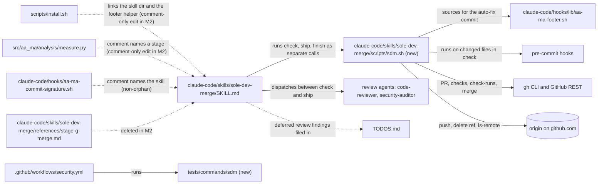
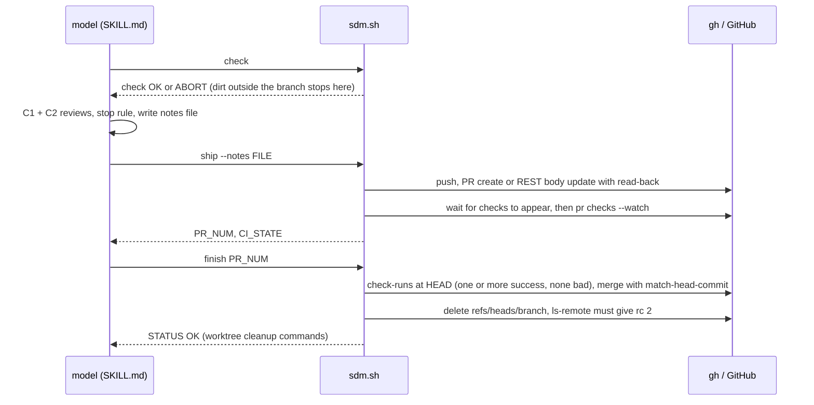
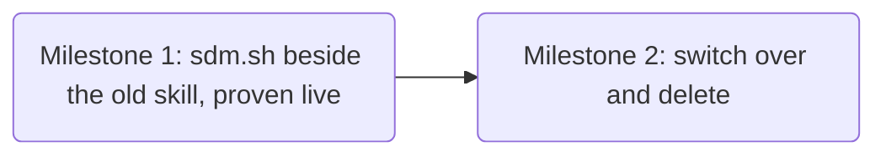

# sole-dev-merge-simplify Plan

**Objective:** Replace `/sole-dev-merge`'s ~2,000 lines of markdown-embedded bash with one bats-tested script, `sdm.sh` (`check` / `ship` / `finish`). GitHub only, with no stage state file, keeping every behaviour that real use proved necessary.
**Owner:** Ste (Stephen Newhouse) + AI
**Created:** 2026-10-20
**Last Updated:** 2026-10-20 (rev 4, after plan-verification: 6/6 angles, 0 open CRITICAL)
**Abbreviations:** PL = `sole-dev-merge-simplify-provenance.log`, CL = `sole-dev-merge-simplify-context-log.md` (both in this task dir).
**Diagram-Waiver:** none
**Branch / worktree:**
- plan: `docs/sole-dev-merge-simplify-plan`
- prototype: `prototype/sdm-script`, never merged
- M1: `refactor/sdm-script`
- M2: `refactor/sdm-switch-over`
- finalize: `chore/sdm-simplify-finalize`
- Each is cut from fresh main (L-037).

**Inputs:** retro `.claude/dev/completed/sole-dev-merge-fixes/sole-dev-merge-fixes-retro-2026-10-20.md` §4 item 6; `docs/research/sole-dev-merge-simplify-gh-cli-merge-contract.md`; `docs/research/sole-dev-merge-simplify-behaviour-inventory.md`; grill decisions in context-log.

## 1. Executive Summary (element #1)
`/sole-dev-merge` is 1,994 lines, 77% of them bash that the model copies out of markdown. That forced a stage state file, copied its loader 13 times, and gave reviewers an ever-larger surface (forge L-060–L-062).
- **M1** writes `claude-code/skills/sole-dev-merge/scripts/sdm.sh`, with its own bats suite and fixtures, next to the old skill. It proves the script live twice.
- **M2** points SKILL.md at the script, deletes the old blocks and their tests, and records ADR-0024.
- The changes ship in the next release, v0.18.0, which code-conventions-impact M14 owns (Ste, 2026-10-20).

## 2. Engineering Standards Declaration (element #12)
Ste chose all six themes.
1. **Verification & Truth:** each milestone is gated by a live run on the real repo, not stubs; the predecessor's stub test certified the `--delete-branch` bug (L-061). M1 is Prototype-Required.
2. **Development Principles:**
   - TDD: RED before GREEN in both milestones.
   - KISS/DRY: one script, one footer resolver, no copies (L-062).
   - SoC: the script does git/gh work; the model does the reviews.
3. **Reasoning & Planning:** 9-question grill; 4 alternatives rejected on evidence (§4); two research files; plan-verification.
4. **Safety & Continuity:**
   - The old skill stays the fallback on main until M2.
   - GitHub users see only the decided changes.
   - GitLab removal goes under CHANGELOG "Removed".
   - Lessons are applied as wired limits (§3).
5. **Execution Checklist:** HARD gates with Critical-Path evidence; TESTS_VERIFIED on the new bats suite.
6. **Sync & Commit Discipline:** a Result Log per sub-step; post-merge records go on the next branch (L-037).

## 3. Threat Model and Review Exit Contract (retro §4 items 1–4)
- **Threat-Model:** carried in each Contract below, so the security-auditor reads it. Local tooling.
  - **Trusted:** the operator, their machine, git config and their own repos' `.git`.
  - **Untrusted:** PR/issue text, remote branch names, fetched content, tool output that reaches a shell.
  - **Out of scope:** hostile repo-local config or planted `.git` files, a concurrent local attacker, git older than 2.53, gh older than 2.46, exotic locales. Operator env values are trusted: validate them only where a bad value hangs or misreports.
- **§6.8 exit:** one run per milestone. A CRITICAL with a failure path under the threat model is fixed, and the fix alone is re-checked once. WARNING/INFO go to TODOS.
- **Merge runs:** the Stage D stop rule. At most 2 review rounds; only CRITICAL/HIGH with a failure path block; MEDIUM/LOW go to reviewer notes plus one TODOS entry.
- **Re-plan trigger:** a CRITICAL that falsifies a plan risk or assumption stops the milestone and goes to Ste.
- **Scope guard:** nothing outside the §6 Contracts is built; a new idea becomes a TODO (L-057).
- **Visible side effects:** `sdm.sh` hides `git push` and `gh pr merge` from the permission prompt. The model therefore runs `check`, `ship` and `finish` as three separate Bash calls, and SKILL.md says that `ship` pushes and `finish` merges and deletes the remote branch.

## 4. Dependencies and Assumptions (element #8)
- **Verified** (Wave 1, `04d2490`):
  - gh 2.46.0 and git 2.53.0; origin is github.com.
  - `main` has no branch protection, no rulesets and auto-merge off; rebase merges are allowed.
  - `security.yml` is the only workflow. It triggers on pull_request, and its 9 jobs all report as check-runs (no commit statuses).
- **gh contract** (research file):
  - `gh pr checks` exits 1 for "no checks reported" (as for a failure); `--watch` does not wait for checks to appear.
  - A cancelled check exits 0.
  - `gh pr merge` does not check CI, and merges an UNSTABLE PR immediately.
  - `--match-head-commit` is GraphQL `expectedHeadOid`: a mismatch gives exit 1 with `GraphQL:` on stderr.
  - `--delete-branch` fails from a linked worktree, after the merge.
  - There is no `pr checks --json`. The combined `/status` endpoint says "pending" when it has 0 statuses, so it is never used.
- **Install path:** `install.sh:316-322` links whole skill dirs, so only a script under `claude-code/skills/sole-dev-merge/scripts/` is installed.
- **Footer helper:** `claude-code/hooks/lib/aa-ma-footer.sh` is self-contained, and install.sh links it into `~/.claude/hooks/lib/`.
- **Alternatives rejected:**
  - `gh pr merge --auto`: with no protection it merges at once, without CI.
  - A Python CLI: the work is git/gh orchestration, and bash needs no venv.
  - A bare checklist: it loses the L-1332/L-052/L-1309 fixes.
  - Interim cut only: Ste chose the rewrite.
- **Test gate:** reference.md carries `Test-Command: bats --formatter pretty -r tests` with `Test-Command-Pass-Regex: ^([0-9]+) tests, 0 failures` (bats 1.13 prints that line; probed). It covers the hook suites and both skill suites; CI runs pytest.
- **Accepted risk:** a review note containing a GitHub closing keyword (`Closes #N`) in the PR body could close an issue on merge. The notes are model-written from findings, so this is accepted (ADR-0024 records it, along with "commit statuses are not gated").
- **Depends on:**
  - PRs #47–#51 on main (stop rule, threat model, G2 appear-wait). Verified.
  - code-conventions-impact M14 cutting v0.18.0.

## 5. Stepwise Plan (elements #2, #4, #5, #6, #9)

### Milestone 1: sdm.sh beside the old skill, proven live (`Prototype-Required: YES`)
Goal: a ≤ 400-line `sdm.sh` with its own fixtures and a bats suite that pins every KEEP behaviour, which has merged two real PRs.

- **1.0 Prototype + deferred work** (HITL, 0.3 d, 45%, Prototype-Required)
  - In `.worktrees/prototype/sdm-script`, write a happy-path `claude-code/skills/sole-dev-merge/scripts/sdm.sh` (check / ship / finish).
  - On `chore/sdm-todo-triage`, close the 7 `/sole-dev-merge` TODOS entries whose code M2 deletes (inventory: TODOS 25, 81, 88, 96, 104, 119, 157); list the rest for 1.1 (L-056).
  - Merge that chore PR by running the prototype by path, with cwd set to the chore worktree, one Bash call per subcommand. It is a TODOS-only PR, so the C1/C2 reviews are skipped (the prototype tests the git/gh path, not the reviews).
  - **AC:**
    - `gh pr view <n> --json state` = MERGED, and PL quotes the prototype's `STATUS: OK` line;
    - `git ls-remote --exit-code origin refs/heads/chore/sdm-todo-triage` gives rc 2;
    - `git rev-parse main` = `origin/main`;
    - the 7 entries are under Completed;
    - CL has `PROTOTYPE FINDINGS: n=<k>` with one line each (k may be 0);
    - PL has `PROTOTYPE — Milestone 1: sdm.sh beside the old skill, proven live — <verdict>`;
    - the prototype branch is not merged.
- **1.1 RED: fixtures and tests** (AFK, 0.6 d, 50%)
  - Create `tests/commands/sdm/fixtures/{bin/gh,bin/pre-commit,helpers.bash}`. Start from the old ones, which stay untouched, then add:
    - a check-runs arm (`repos/{o}/{r}/commits/<sha>/check-runs?filter=latest&per_page=100`) answered from env `GH_CHECK_RUNS`, one `status conclusion` pair per line;
    - an rc control for the G1 `allow_rebase_merge` call;
    - `pr checks` rows;
    - a GraphQL-error arm for a `--match-head-commit` mismatch;
    - field-order-free `pr view` matching.
  - Port the 102 KEEP/CHANGE tests in the inventory's "Per-test map" into the target files it names: `tests/commands/sdm/{check,ship,finish}.bats`.
  - Turn each still-open TODO listed in 1.0 into a test here, or name it in the Result Log as carried.
  - Add these new tests:
    1. a cancelled check is not green;
    2. all check-runs `skipped` → `finish` refuses;
    3. `finish` needs every run `completed`, ≥ 1 `success`, and every conclusion in success/skipped/neutral; an in-progress run is refused with `STATUS: CI_NOT_DONE`;
    4. the CI_TIMEOUT hint is `sdm.sh finish <n>` once CI completes, never `gh pr merge --auto` (it would merge at once with no protection);
    5. a G1 API failure is not "rebase allowed";
    6. a G4 plain-checkout failure prints a STATUS line;
    7. a `--match-head-commit` mismatch (GraphQL error, rc 1) aborts with no branch delete;
    8. a run from a subdirectory;
    9. the exit-status table in `sdm.sh help` matches its `STATUS:`/`ABORT:` lines;
    10. `finish abc` / `finish 0` abort before any gh call;
    11. `allow_rebase_merge` = `null` (rc 0) aborts;
    12. a local HEAD that differs from the PR's headRefOid (unpushed commit) aborts before the merge;
    13. the merge call fails, or the PR is not MERGED afterwards → no branch delete.
  - **AC:**
    - `bats --count tests/commands/sdm` = N, recorded in the Result Log; N = 102 + the new tests ≥ 115;
    - a RED log in the Result Log lists each new test with its failure line;
    - the RED commit precedes any GREEN.
- **1.2 GREEN: complete sdm.sh** (AFK, 0.5 d, 55%)
  - **AC:**
    - `bats --formatter pretty tests/commands/sdm` prints `N tests, 0 failures` (N from 1.1);
    - `pre-commit run --files claude-code/skills/sole-dev-merge/scripts/sdm.sh $(find tests/commands/sdm -type f)` passes (shellcheck with the touched-job args, plus check_conventions);
    - `git ls-files -s` shows mode 100755 for sdm.sh;
    - `wc -l sdm.sh` ≤ 400. Today's 1,541 bash lines are about 62% DROP (state 24%, GitLab ~10%, scanners/guards, re-validation), and the design audit sized the script at 150–200 lines;
    - `grep -c '^sdm_footer()' sdm.sh` = 1;
    - `grep -nE '^[^#]*\b(glab|SDM_STATE|pytest|mypy)\b|^[^#]*(--select S|shellcheck )' sdm.sh` gives 0;
    - `bats --formatter pretty tests/commands/sole-dev-merge` prints `199 tests, 0 failures`, and `git diff origin/main -- claude-code/skills/sole-dev-merge/SKILL.md claude-code/skills/sole-dev-merge/references` is empty;
    - `scripts/regen-generated.sh` leaves `git diff --exit-code` clean; if it changes the plugin-surface golden, commit that here;
    - `uv run pytest` passes.
- **1.3 CI runs the new suite** (AFK, 0.1 d, 20%)
  - **AC:** `grep -c 'tests/commands/sdm' .github/workflows/security.yml` ≥ 1. The PR's `Bats` check passing with the new count in its log is observed at 1.4, after `ship` pushes.
- **1.4 Verify, gate, merge by the new script** (HITL, 0.25 d, 40%)
  - The §6.7 fences and §6.8 run once under §3.
  - The model runs the branch's `sdm.sh` by path, each subcommand as its own Bash call: `check`, then the C1/C2 reviews, then `ship --notes <file>`, then `finish <n>`.
    - For the reviews, use only the C1/C2 agent prompts in `references/stage-c-review-and-security.md` with the stop rule, and skip the aggregate/triage bash. That bash needs the old state file, which `sdm.sh check` never creates.
    - The notes file is a `mktemp` file holding the MEDIUM/LOW lines in the severity contract `[SEV] <line> — <path>:<line>`.
    - `/sole-dev-merge` would load main's old skill.
  - **AC:**
    - PR MERGED, and PL quotes `sdm.sh finish`'s `STATUS: OK` line;
    - ls-remote rc 2;
    - main = origin/main;
    - the Result Log has the PR number and the number of merge runs (target 1).

### Milestone 2: switch over and delete
Goal: SKILL.md is ≤ 150 lines that call `sdm.sh`; the old blocks, state-file docs and their tests are gone; CI stays green at every commit.

- **2.0 Post-merge record of M1** (HITL, 0.1 d, 20%)
  - **AC:**
    - reference.md has a SHA map: the PR's commit subjects (`gh pr view <n> --json commits`) matched against `git log` of the merged range on origin/main;
    - `uv run aa-ma-gate tasks.md --milestone 1 --format kv` shows `pending_steps=0`;
    - CL has `GATE APPROVAL: Milestone 1`.
  - Recorded on the M2 branch (L-037).
- **2.1 (merged into 2.2)**: kept as a number so the IDs stay stable; `Status: SKIPPED — folded into 2.2` in tasks.md.
- **2.2 The switch, as one commit** (AFK, 0.5 d, 45%)
  - Hook tests: in `tests/hooks/aa-ma-footer.bats:167-206`, re-point the 2 tests that run the B-commit footer at `sdm_footer` (source sdm.sh). Drop the D-block run and the "snippets byte-identical" test, which have nothing left to test. In `tests/hooks/commit-signature.bats:228-240`, drop the 2 block-shape tests; the generic rule-8 tests at 156-226 stay.
  - Rewrite SKILL.md: `sdm.sh check`, then reviews C1+C2 (prompts, threat model, stop rule, notes file), then `ship --notes <file>`, then `finish <PR>`, then the exit-status table. It says which steps push or merge.
  - Delete the six `references/*.md`, the 11 old bats files and `tests/commands/sole-dev-merge/` (fixtures included).
  - Point `security.yml` at `tests/commands/sdm/` only, and fix comments 145-158 and "60+".
  - Update the rule-8 comment in `aa-ma-commit-signature.sh:149-153`, keeping the `/sole-dev-merge` token so the skill is not an orphan.
  - Run `scripts/regen-generated.sh`.
  - The commit subject must not start with `refactor(skills): split sole-dev-merge `.
  - **AC:**
    - `disable-model-invocation: true` is kept;
    - `grep -cE 'sdm\.sh (check|ship|finish)' SKILL.md` ≥ 3;
    - no fenced block in SKILL.md is longer than 3 lines;
    - `wc -l SKILL.md` ≤ 150 (today's prose is 317 lines, most of it GitLab, scanner and stage-pointer text);
    - `test ! -e claude-code/skills/sole-dev-merge/references && test ! -e tests/commands/sole-dev-merge`;
    - `grep -c 'tests/commands/sole-dev-merge\|60+' .github/workflows/security.yml` = 0;
    - `grep -rn 'extract_stage\|sole-dev-merge.env\|SDM_KEYS' claude-code tests .github --exclude-dir=fixtures` gives 0 (the frozen draw snapshots in `tests/fixtures/` keep their old strings);
    - `grep -c '/sole-dev-merge' claude-code/hooks/aa-ma-commit-signature.sh` ≥ 1;
    - `uv run pytest` and `bats -r tests` both 0 failures;
    - regen leaves `git diff --exit-code` clean.
- **2.3 Docs** (AFK, 0.25 d, 30%)
  - ADR-0024, "/sole-dev-merge is one tested script; GitHub only". It partly supersedes ADR-0008: a status line plus an INDEX row.
  - ADR-0022 and ADR-0018 amendment notes.
  - CONTEXT.md: retire "Stage state file"; add "Stop rule".
  - README.md:226, `docs/spec/claude-code-foundations.md:91`, `docs/spec/aa-ma-quick-reference.md:156-157`.
  - Stale comments in `scripts/install.sh:385`, `src/aa_ma/analysis/measure.py:5` and `claude-code/hooks/lib/aa-ma-footer.sh:4-5`.
  - CHANGELOG Unreleased: Changed, and Removed "GitLab/glab support; last in v0.17.0".
  - Lessons "Fixed in" pointers; TODOS entries re-homed.
  - **AC:**
    - `test -f docs/adr/0024-sole-dev-merge-one-script.md`;
    - `grep -c 0024 docs/adr/INDEX.md` ≥ 1;
    - `grep -ci supersed docs/adr/0008-sole-dev-merge-pr-workflow.md` ≥ 1;
    - `grep -c 'Stage state file' CONTEXT.md` = 0 and `grep -c 'Stop rule' CONTEXT.md` ≥ 1;
    - `grep -c 'GitLab/glab support; last in v0.17.0' CHANGELOG.md` = 1;
    - `grep -c 'stage-d-triage' claude-code/hooks/lib/aa-ma-footer.sh` = 0;
    - `grep -rni 'glab\|gitlab' claude-code/skills/sole-dev-merge` gives 0;
    - `uv run pytest` passes.
- **2.4 Verify, gate, merge, finalize** (HITL, 0.25 d, 40%)
  - §6.7/§6.8 under §3.
  - The model follows the worktree's new SKILL.md and runs its `sdm.sh` by path.
  - Run `scripts/install.sh`.
  - Finalize and archive on `chore/sdm-simplify-finalize`.
  - **AC:**
    - PR MERGED with `STATUS: OK` quoted in PL;
    - `test -x "$(readlink -f ~/.claude/skills/sole-dev-merge/scripts/sdm.sh)"`;
    - FINALIZATION approved by Ste;
    - the plan dir is under `.claude/dev/completed/`.

## 6. Milestones with Contracts (elements #3, #10, #13)

### Milestone 1: sdm.sh beside the old skill, proven live
#### Contract
```
Audit-Profile: full
Critical-Path: hook-modification   # security.yml; and the merge gate (CI wait, merge) inside claude-code/skills/**
Prototype-Required: YES
Gate: HARD
Threat-Model: local tooling — trusted: operator, their machine, git config, own repos' .git; untrusted: PR/issue text, remote branch names, fetched content, tool output reaching a shell; out of scope: hostile repo-local config, planted .git files, concurrent local attacker, git < 2.53, gh < 2.46, exotic locales
Complexity: 55%
Effort: 1.75 days
Files:
  Create  claude-code/skills/sole-dev-merge/scripts/sdm.sh            # mode 100755
  Create  tests/commands/sdm/check.bats tests/commands/sdm/ship.bats tests/commands/sdm/finish.bats
  Create  tests/commands/sdm/fixtures/bin/gh tests/commands/sdm/fixtures/bin/pre-commit tests/commands/sdm/fixtures/helpers.bash
  Modify  .github/workflows/security.yml          # bats job also runs tests/commands/sdm/
  Modify  tests/golden/plugin-surface.json docs/architecture/plugin-surface.md   # only if scripts/regen-generated.sh changes them
  Modify  TODOS.md
CLI (sdm.sh, bash, set -euo pipefail; sourceable: main runs only when "${BASH_SOURCE[0]}" == "$0"):
  sdm.sh check                    # A + B + B-commit. 0 = "check OK (branch=<b>, base=<ref>, ahead=<n>)"; 1 = ABORT: <reason>
                                  # dirt outside the branch: "ABORT: check: files outside the branch changed: <list> (left as they are)"
                                  # pre-commit stays best-effort: prints "check: pre-commit rc=<n>" and goes on
  sdm.sh ship [--notes FILE]      # origin on github.com, gh auth, body, push, PR create or REST update + read-back, G1, G2.
                                  # prints three lines PR_NUM=<n>, PR_URL=<u>, CI_STATE=green|failed|timeout; STATUS lines exit 0; ABORT exit 1
                                  # body in a mktemp file removed by an EXIT trap; PATCH with `gh api -F body=@file`, read-back trims trailing newlines
                                  # repo slug from origin's URL, passed as -R/explicit path; origin not on github.com -> ABORT naming the host only (never the URL)
                                  # the PR is used only if OPEN, isCrossRepository=false and headRefOid == local HEAD; decide on gh's rc, never on stdout
                                  # `pr checks --watch` output goes to /dev/null; only the three lines reach stdout
  sdm.sh finish <PR_NUM>          # PR_NUM must match ^[1-9][0-9]*$ before any gh argv; SHA=$(git rev-parse HEAD), used for check-runs and --match-head-commit;
                                  # one lookup: headRefName == current branch (not the default; check-ref-format), isCrossRepository=false, state OPEN, headRefOid == SHA;
                                  # strategy re-read from allow_rebase_merge: only literal true/false; null or an API failure ABORTs;
                                  # check-runs at SHA: total_count == runs read (else ABORT), all completed, >=1 success, all in success|skipped|neutral,
                                  #   else STATUS: CI_NOT_DONE / CI_FAILED;
                                  # merge --<strategy> --match-head-commit "$SHA"; re-read state, MERGED required before any delete;
                                  # push origin :refs/heads/<b> (rc captured, not acted on); ls-remote --exit-code decides: 2 gone, 0 BRANCH_NOT_DELETED, else error; G4
                                  # exit: 0 = STATUS lines, 1 = ABORT
  sdm.sh help                     # usage + the exit-status table
Functions: sdm_footer (the one footer resolver: AA_MA_FOOTER_HELPER, repo copy, ~/.claude link, else [ad-hoc])
Env (operator, trusted; validated only where a bad value hangs): CI_POLL_TIMEOUT (900s), CI_APPEAR_TIMEOUT_S (120), CI_APPEAR_INTERVAL_S (10), AA_MA_FOOTER_HELPER, AA_MA_PLAN_DIR
Kept STATUS/ABORT texts: the inventory's KEEP strings, verbatim, except that a "Stage F:"/"Stage G2:"/"Stage G3:"/"Stage G4:" prefix becomes "ship:"/"finish:"; "Cannot run /sole-dev-merge from <b> branch" is unchanged.
Exit table: in sdm.sh between the comment lines "# exit-table:begin" and "# exit-table:end", one "STATUS-or-ABORT text | meaning" row per line; `sdm.sh help` prints it.
```
Risks:
1. **The live merge exposes a gh edge the stubs miss** (as `--delete-branch` did). Mitigation: the prototype merges a real PR before the suite is written; the old skill stays the fallback.
2. **Porting 102 tests drags the old surface back in.** Mitigation: port only the KEEP/CHANGE list; a test asserting a DROP behaviour is not ported.
3. **`finish` merges on a stale or empty green.** Mitigation: re-read the head's check-runs (≥ 1 success, no bad conclusion) plus `--match-head-commit`.

### Milestone 2: switch over and delete
#### Contract
```
Audit-Profile: full
Critical-Path: hook-modification   # security.yml, the commit-signature hook comment, and the skill text the merge gate runs from
Threat-Model: as Milestone 1
Gate: HARD
Complexity: 40%
Effort: 1.1 days
Files:
  Modify  claude-code/skills/sole-dev-merge/SKILL.md
  Delete  claude-code/skills/sole-dev-merge/references/stage-c-review-and-security.md stage-d-triage.md stage-e-remote-and-body.md stage-f-push.md stage-g-merge.md stage-state.md
  Delete  tests/commands/sole-dev-merge/            # 11 bats files and their fixtures (glab, extract_stage.sh included)
  Modify  tests/hooks/aa-ma-footer.bats tests/hooks/commit-signature.bats .github/workflows/security.yml
  Modify  claude-code/hooks/aa-ma-commit-signature.sh   # rule-8 comment only; keeps the /sole-dev-merge token
  Modify  tests/golden/plugin-surface.json docs/architecture/plugin-surface.md   # via scripts/regen-generated.sh
  Create  docs/adr/0024-sole-dev-merge-one-script.md
  Modify  docs/adr/0008-sole-dev-merge-pr-workflow.md docs/adr/0022-secops-baseline.md docs/adr/0018-touched-code-lint-gate.md docs/adr/INDEX.md
  Modify  CONTEXT.md README.md docs/spec/claude-code-foundations.md docs/spec/aa-ma-quick-reference.md CHANGELOG.md TODOS.md docs/lessons.md
  Modify  claude-code/hooks/lib/aa-ma-footer.sh scripts/install.sh src/aa_ma/analysis/measure.py   # comments only
```
Risks:
1. **The deletion breaks a hidden reader.** Mitigation: Wave 1's impact angle listed every reader; the AC greps plus full pytest and `bats -r tests`; the switch lands as one commit, so CI is never red in between.
2. **The skill becomes an orphan on the plugin surface.** Mitigation: keep the `/sole-dev-merge` token in the hook comment; regenerate the golden.
3. **The next release picks up a half-documented change.** Mitigation: the 2.3 CHANGELOG ACs land before 2.4's merge; M14 of code-conventions-impact cuts v0.18.0 from a complete Unreleased section.

## 7. Rollback Strategy (element #7)
- **M1** adds files and one CI step. Revert its merge commits; the old skill keeps working throughout.
- **M2:** `git revert` the switch commit and the docs commits, which restores SKILL.md, the references and the tests; `scripts/install.sh` re-links. No release depends on it until code-conventions-impact M14 cuts v0.18.0.
- **A live run that fails mid-merge:** each `STATUS:` line has a manual recovery (inventory); the remote branch delete is checked with ls-remote.

## 8. Effort & Complexity Summary (element #9)
| Milestone | Effort | Complexity | Gate |
|---|---|---|---|
| M1 | 1.75 d | 55% | HARD |
| M2 | 1.1 d | 40% | HARD |

No step reaches the 80% threshold.

## 9. Review Focus (writing-plans)
1. **A cancelled, skipped-only or empty CI run** must not merge. `finish` requires ≥ 1 `success` and no failure/cancelled/timed_out/action_required (finish.bats tests 1–3).
2. **A PR pushed to after `ship`:** the `--match-head-commit` mismatch is a GraphQL error with rc 1. `finish` aborts and deletes nothing (finish.bats test 7).
3. **A run from a subdirectory:** `check` uses the git toplevel, and G4 uses absolute `--git-dir` (test 8).
4. **A branch name with a slash, or that is also a tag:** delete by `refs/heads/<b>` and probe by the full ref (ported g_merge tag test, plus a `feat/x` case).
5. **A notes file that is missing or empty:** the body says `(none)` and `ship` proceeds (ported E3 test).

## 10. Next Action (element #11)
Merge this plan (docs only) with the current `/sole-dev-merge`. Then cut `prototype/sdm-script` and `chore/sdm-todo-triage` from fresh main and start Sub-step 1.0. AA-MA file to update first: `sole-dev-merge-simplify-tasks.md` (Milestone 1 ACTIVE).

## 13. Architecture View
Seed note: `codemem draw --level L2` over the files this plan modifies returned 0 nodes / 0 edges after `codemem build`. codemem indexes Python, and these are shell, YAML and markdown. The edges are prose and carry no sigils.

### Component view


### Flow view


### Milestone graph


