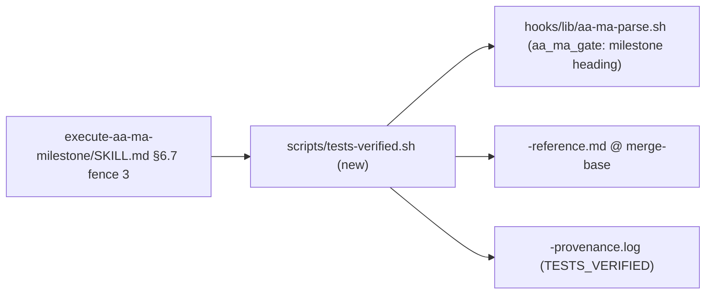

# 0023. Tests-Verified Gate (§6.7 Fence 3)

**Status:** Accepted
**Date:** 2026-10-13
**Deciders:** Ste
**Tags:** `workflow`, `gate`, `testing`

## Context and Problem Statement

The §6.7 HARD gate of `/execute-aa-ma-milestone` listed "tests pass" as condition 3, but only as a
comment ("already enforced in 6.4; double-check Result Log mentions"). Nothing ran the suite, so a
milestone could be marked COMPLETE on a Result Log that said the tests passed. How does the gate
prove, at the boundary, that the plan's own test suite passes, for pytest repos and for the R,
Nextflow and other runners Ste ships?

## Decision Drivers

- The proof must be the gate running the tests, not a sentence about them.
- A branch must not be able to self-pass by editing what the gate runs (plan §0 v2).
- Non-pytest runners (testthat, nf-test, …) must be able to pass (scope change, 2026-10-13, G2/G9).
- `execute-aa-ma-milestone/SKILL.md` is at the 500-line cap (`tests/test_prompt_size.py`), and the
  first two §6.7 fences are executed by position in other test suites.
- Fail closed: a check that could not run, or a summary that cannot be read, is not a pass.

## Considered Options

1. **Inline fence 3 in SKILL.md** — about 100 lines of bash in the third §6.7 block.
2. **Thin fence + skill script** — a short third block that runs `scripts/tests-verified.sh`.
3. **Python CLI** (`aa-ma-tests-verified`, in the style of `aa-ma-gate`).

## Decision Outcome

**Chosen:** Option 2, thin fence + skill script.

The third `bash` block in §6.7 resolves `claude-code/skills/execute-aa-ma-milestone/scripts/tests-verified.sh`
(the repo's copy first, then `~/.claude`) and runs it. The script:

- reads `Test-Command:` (default `uv run pytest`) and the optional `Test-Command-Pass-Regex:` from the
  **merge-base** copy of `<task>-reference.md`;
- rejects `; | & $ ` < >` in the command, splits it with `shlex` and runs it as an argv (never
  `bash -c`) under `${AA_MA_TEST_TIMEOUT:-540}` seconds;
- passes only on rc 0 **and** a summary that names the pass count: by default pytest's final line
  (banner stripped) matching `(^|, )([0-9]+) passed`; with a Pass-Regex, the **last** output line
  that matches it, whose group 1 must be all digits;
- appends `[ts] TESTS_VERIFIED — <milestone heading> — passed=N cmd=<TEST_CMD>` to provenance.log,
  and BLOCKS with no line otherwise. A failing run is never retried.

**Opt-out (D10).** `Test-Command: none — <reason>` writes `TESTS_VERIFIED — <heading> — skipped: <reason>`
only when context-log.md holds `## [date] GATE APPROVAL: Test-Command none — <milestone heading>`
followed by `- Decision: APPROVED`. It is the same form and the same HEAD-side read as §7.1's approval.

**Rationale:** Option 2 is the only one that keeps SKILL.md under its cap without moving the gate
out of the skill. It keeps the Pass-Regex as bash ERE, the semantics Ste approved for the scope
change, and it ships with the skill symlink, so `install.sh` needs no change.

## Pros and Cons of the Options

### Option 1 — Inline fence

- ✅ Everything visible in one file.
- ❌ SKILL.md would exceed 500 lines; the cap's ALLOWLIST is empty by test and must stay so.

### Option 2 — Thin fence + skill script

- ✅ SKILL.md stays under its 500-line cap (`tests/test_prompt_size.py`); the logic is shellcheck-clean,
  bats-tested (`tests/hooks/test_tests_verified.bats`) and mutation-checked.
- ✅ Bash ERE for the Pass-Regex, as approved.
- ❌ A second file to read to see the full rule. Mitigated by `references/gate-fences.md`.

### Option 3 — Python CLI

- ✅ Matches ADR-0009's "bash asks, Python answers" for the gate.
- ❌ The Pass-Regex would become Python `re`, not the approved bash ERE; needs a new entry point.

## Consequences

**Positive:**
- COMPLETE now needs the suite to pass, at the boundary, with the count recorded.
- R (testthat), Nextflow and other runners can pass through `Test-Command-Pass-Regex:`.
- Inputs are read from the merge-base copy, so a branch cannot change the command or the pass
  rule that prove it (it still controls the code and test configuration under test). A plan
  whose reference.md is new on the branch uses its HEAD copy, with a notice (§6.6, Ste); a branch
  forked before an existing plan reached the default branch uses the default branch's copy
  (background review). The argv split runs `python3 -I` (§6.8: a repo `shlex.py` cannot hijack it).
- `timeout -k` (GNU coreutils `timeout(1)`): 124 = timed out, 137 = 128 + SIGKILL after the grace.
- The approval check is block-scoped and shared with §7.1 (`aa_ma_has_gate_approval`); the
  `grep -A8` it replaced let a REJECTED block borrow the next block's APPROVED (§6.6).

**Negative:**
- The gate takes as long as the suite (the forge: about 2 minutes). Suites over 540 s raise
  `AA_MA_TEST_TIMEOUT` and run the fence in the background.
- Residual risk: a runner that exits 0 on failure **and** prints an earlier line matching the
  Pass-Regex. Write the regex to require zero failures, as `\[ FAIL 0 \| … PASS ([0-9]+) \]` does.
- A flaky test now blocks COMPLETE; the remedy is to fix it or re-run the gate by hand.

**Neutral:**
- `TESTS_VERIFIED` goes live after the M9 merge and `install.sh` (D7): Milestone 10's gate is the
  first to write it.
- The script refuses to append through a symlinked provenance path. Other AA-MA appenders do not
  yet (TODOS, P1).

## Architecture View (recommended)

### Component view


## Example (recommended)

```text
# <task>-reference.md (merge-base copy)
Test-Command: Rscript -e "testthat::test_dir('tests')"
Test-Command-Pass-Regex: \[ FAIL 0 \| WARN [0-9]+ \| SKIP [0-9]+ \| PASS ([0-9]+) \]

# provenance.log, on a pass
[2026-10-20T10:00:00+01:00] TESTS_VERIFIED — Milestone 3: Fit the model — passed=12 cmd=Rscript -e "testthat::test_dir('tests')"
```

## Implementation Notes

- Fence: `claude-code/skills/execute-aa-ma-milestone/SKILL.md` §6.7, the third `bash` block (the
  first two keep their places; `aa-ma-gate-python.bats` and `test_diagram_verified.bats` run them).
- Logic: `claude-code/skills/execute-aa-ma-milestone/scripts/tests-verified.sh`.
- Contract and verdict table: `claude-code/skills/execute-aa-ma-milestone/references/gate-fences.md`.
- Tests: `tests/hooks/test_tests_verified.bats`.
- Template and scribe: `docs/templates/reference-template.md`, `claude-code/agents/aa-ma-scribe.md`.

## References

- code-conventions-impact plan, Milestone 9 (T11 §5), and its 2026-10-13 scope change (context-log).
- ADR-0009 (gate questions from the Python SSoT), ADR-0015 (§13 diagram fence).
- testthat Reporter docs (summary format): <https://testthat.r-lib.org/reference/Reporter.html>.
