<!-- generated by codemem draw @ 0bf9c6c2 on 2026-10-28 -->
# I/O boundary

Where the code touches databases, HTTP, files, subprocesses, env and queues (tests excluded).

One arrow per file, labelled with its call count. Solid: a catalogued call (`sqlite3.connect`). Dashed: a catalogued method on a receiver of unknown type (`conn.execute`) — low confidence. Catalogue: `codemem/draw/sinks.yaml`. Not seen: calls outside a named function or method — module scope, and TS/JS arrow functions bound to a `const` — and `os.environ[...]` / `process.env`.

```mermaid
flowchart LR
  subgraph io_python["python"]
    io_python_db[("database")]
    io_python_env[("environment")]
    io_python_fs[("filesystem")]
    io_python_subprocess[("subprocess")]
  end
  n1g79hvc["claude-code/codemem/mcp/server.py"]
  n15x2rwo["packages/codemem-mcp/src/codemem/analysis/git_mining.py"]
  n1qqv388["packages/codemem-mcp/src/codemem/cli.py"]
  n65kjls["packages/codemem-mcp/src/codemem/draw/captions.py"]
  nx760e7["packages/codemem-mcp/src/codemem/draw/cut.py"]
  n1c2obja["packages/codemem-mcp/src/codemem/draw/io_sinks.py"]
  n1a46oz0["packages/codemem-mcp/src/codemem/draw/plugin_surface.py"]
  nlswb4j["packages/codemem-mcp/src/codemem/draw/views.py"]
  nkvneqs["packages/codemem-mcp/src/codemem/gitutil.py"]
  n1qndr8e["packages/codemem-mcp/src/codemem/incremental.py"]
  nn471i1["packages/codemem-mcp/src/codemem/indexer.py"]
  n44kqyb["packages/codemem-mcp/src/codemem/journal/lock.py"]
  n1eygstq["packages/codemem-mcp/src/codemem/journal/wal.py"]
  n12ip3u5["packages/codemem-mcp/src/codemem/mcp_tools/__init__.py"]
  ng0fem3["packages/codemem-mcp/src/codemem/pagerank.py"]
  n15008dx["packages/codemem-mcp/src/codemem/parser/ast_grep.py"]
  n43tqi["packages/codemem-mcp/src/codemem/paths.py"]
  n7xp1xs["packages/codemem-mcp/src/codemem/resolver.py"]
  n1q5oakk["packages/codemem-mcp/src/codemem/safety.py"]
  ns1j8lg["packages/codemem-mcp/src/codemem/storage/db.py"]
  n1vgapiq["scripts/bench_codemem.py"]
  nh6b312["scripts/bench_codemem_vs_aider.py"]
  nc2fglq["scripts/bench_sweep.py"]
  nvvfr9z["scripts/check_codemem_doc_drift.py"]
  nhe76ps["scripts/check_conventions.py"]
  nx9efue["src/aa_ma/analysis/cli.py"]
  npp9r16["src/aa_ma/analysis/finalize.py"]
  neg5j5k["src/aa_ma/analysis/measure.py"]
  npsr9fy["src/aa_ma/analysis/models.py"]
  n14i4417["src/aa_ma/analysis/run.py"]
  nudmz03["src/aa_ma/analysis/secrets.py"]
  n7ka9o3["src/aa_ma/analysis/stamp.py"]
  n1qtlbi7["src/aa_ma/deps.py"]
  n1o3m0ll["src/aa_ma/enforce.py"]
  n1kesimv["src/aa_ma/gitutil.py"]
  n1x365od["src/aa_ma/impact.py"]
  n1r3ibca["src/aa_ma/logsetup.py"]
  nptipq4["src/aa_ma/render/cli.py"]
  napjvke["src/aa_ma/render/graph.py"]
  nacfyc9["src/aa_ma/render/mermaid_lint.py"]
  n19z0p6l["src/aa_ma/tui/parser.py"]
  n1g79hvc e0@-->|"1"| io_python_env
  n15x2rwo e1@-->|"3"| io_python_db
  n15x2rwo e2@-->|"1"| io_python_subprocess
  n1qqv388 e3@-->|"1"| io_python_db
  n65kjls e4@-->|"1"| io_python_fs
  nx760e7 e5@-->|"1"| io_python_db
  n1c2obja e6@-->|"1"| io_python_db
  n1c2obja e7@-->|"1"| io_python_fs
  n1a46oz0 e8@-->|"2"| io_python_fs
  nlswb4j e9@-->|"4"| io_python_fs
  nlswb4j e10@-->|"1"| io_python_subprocess
  nkvneqs e11@-->|"1"| io_python_subprocess
  n1qndr8e e12@-->|"1"| io_python_db
  n1qndr8e e13@-->|"7"| io_python_fs
  n1qndr8e e14@-->|"1"| io_python_subprocess
  nn471i1 e15@-->|"2"| io_python_db
  nn471i1 e16@-->|"5"| io_python_fs
  nn471i1 e17@-->|"1"| io_python_subprocess
  n44kqyb e18@-->|"1"| io_python_fs
  n1eygstq e19@-->|"1"| io_python_db
  n1eygstq e20@-->|"2"| io_python_fs
  n12ip3u5 e21@-->|"1"| io_python_db
  n12ip3u5 e22@-->|"1"| io_python_fs
  n12ip3u5 e23@-->|"1"| io_python_subprocess
  ng0fem3 e24@-->|"1"| io_python_db
  ng0fem3 e25@-->|"2"| io_python_fs
  n15008dx e26@-->|"1"| io_python_env
  n15008dx e27@-->|"1"| io_python_subprocess
  n43tqi e28@-->|"1"| io_python_env
  n7xp1xs e29@-->|"2"| io_python_db
  n1q5oakk e30@-->|"1"| io_python_db
  n1q5oakk e31@-->|"1"| io_python_env
  n1q5oakk e32@-->|"4"| io_python_fs
  ns1j8lg e33@-->|"3"| io_python_db
  ns1j8lg e34@-->|"2"| io_python_fs
  n1vgapiq e35@-->|"2"| io_python_fs
  n1vgapiq e36@-->|"1"| io_python_subprocess
  nh6b312 e37@-->|"5"| io_python_fs
  nh6b312 e38@-->|"1"| io_python_subprocess
  nc2fglq e39@-->|"5"| io_python_fs
  nc2fglq e40@-->|"1"| io_python_subprocess
  nvvfr9z e41@-->|"3"| io_python_fs
  nvvfr9z e42@-->|"1"| io_python_subprocess
  nhe76ps e43@-->|"1"| io_python_env
  nhe76ps e44@-->|"1"| io_python_subprocess
  nx9efue e45@-->|"1"| io_python_fs
  npp9r16 e46@-->|"1"| io_python_env
  npp9r16 e47@-->|"7"| io_python_fs
  neg5j5k e48@-->|"1"| io_python_env
  neg5j5k e49@-->|"8"| io_python_fs
  npsr9fy e50@-->|"1"| io_python_fs
  n14i4417 e51@-->|"1"| io_python_fs
  n14i4417 e52@-->|"2"| io_python_subprocess
  nudmz03 e53@-->|"6"| io_python_fs
  nudmz03 e54@-->|"1"| io_python_subprocess
  n7ka9o3 e55@-->|"1"| io_python_env
  n7ka9o3 e56@-->|"1"| io_python_fs
  n7ka9o3 e57@-->|"1"| io_python_subprocess
  n1qtlbi7 e58@-->|"1"| io_python_fs
  n1o3m0ll e59@-->|"1"| io_python_fs
  n1kesimv e60@-->|"1"| io_python_subprocess
  n1x365od e61@-->|"1"| io_python_env
  n1x365od e62@-->|"2"| io_python_fs
  n1x365od e63@-->|"1"| io_python_subprocess
  n1r3ibca e64@-->|"1"| io_python_env
  nptipq4 e65@-->|"5"| io_python_fs
  napjvke e66@-->|"3"| io_python_db
  napjvke e67@-->|"1"| io_python_env
  napjvke e68@-->|"1"| io_python_fs
  nacfyc9 e69@-->|"1"| io_python_env
  nacfyc9 e70@-->|"4"| io_python_fs
  nacfyc9 e71@-->|"1"| io_python_subprocess
  n19z0p6l e72@-->|"3"| io_python_fs
  classDef qualified stroke-width:2px,stroke-dasharray:0
  classDef bare stroke-dasharray:4 4
  class e0,e2,e10,e11,e13,e14,e16,e17,e23,e26,e27,e28,e31,e32,e35,e36,e37,e38,e39,e40,e42,e43,e44,e46,e47,e48,e49,e51,e52,e53,e54,e55,e57,e60,e61,e62,e63,e64,e66,e67,e69,e70,e71 qualified
  class e1,e3,e4,e5,e6,e7,e8,e9,e12,e15,e18,e19,e20,e21,e22,e24,e25,e29,e30,e33,e34,e41,e45,e50,e56,e58,e59,e65,e68,e72 bare
```

